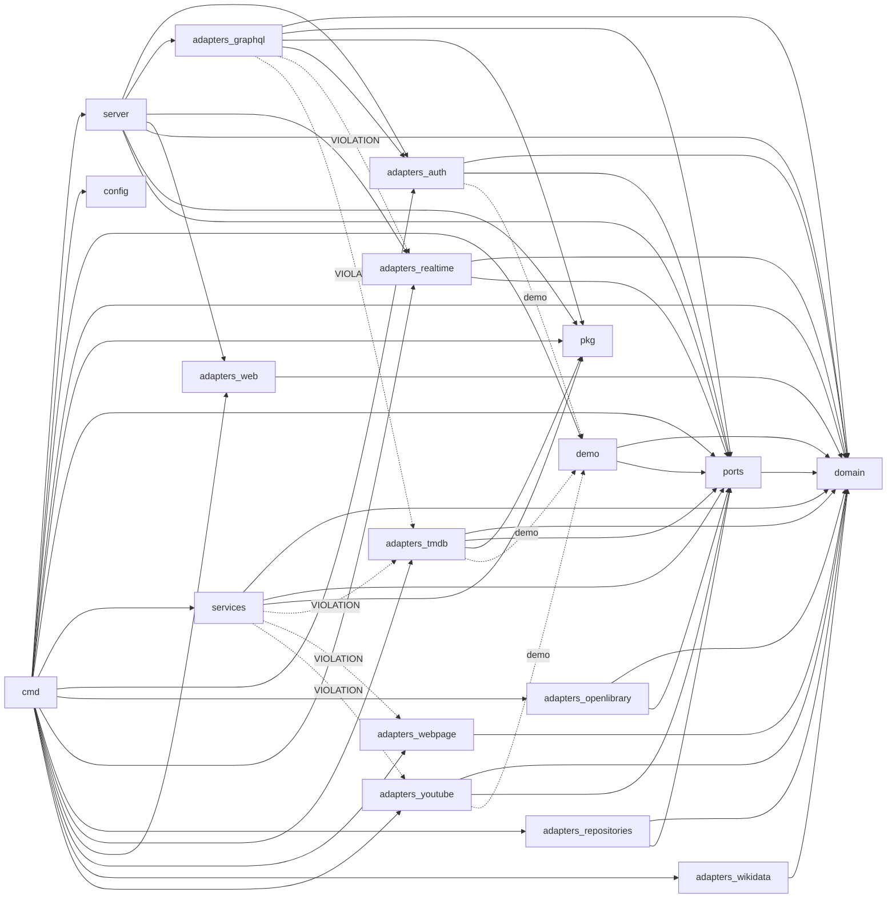

# AI-coding workflow trial: backend (Go) log

- Worked on a local branch `ai-trial/backend`, cut from `origin/main` at `92c03c5`. That branch is not pushed.
- Status: **Phases 0 to 5 are done.** This log covers Phases 0 to 4; the cross-track findings are in `docs/ai-trial-summary.md`.
- The guardrail code the trial built in Phases 2 and 3 (check script, hook, nested `CLAUDE.md`, `go-arch-lint` config, `archcheck` tool, baseline) is **not part of this change**. It is kept as a patch against `92c03c5` in `docs/ai-trial-evidence/guardrails/backend-phase2-3.patch`, because `main` has since gained its own enforcement of the same ground (#861) and the two would collide. Paths named in this log, such as `backend/scripts/check.sh` and `backend/internal/CLAUDE.md`, exist on the trial branch and in that patch, not on `main`.

Evidence labels used below:

- **Re-run** = I re-ran the measurement or tool myself after the discovery agent reported it, and it matched.
- **Agent-measured** = produced by the discovery agent's script (named), not independently re-run.
- **Inferred** = reasoning, not a measurement.

## Phase 0: Architecture discovery

### 0.1 Architecture as it exists

**Facts:** Go 1.27.2, single module (`github.com/CodeWarrior-debug/perspectize/backend`), no `go.work`, no vendoring. 46 packages, 159 non-test files (2 generated), 219 test files, 95 production import edges, **no import cycles**. Build tag `perf` covers 2 files. Generated code to exclude: `internal/adapters/graphql/generated/generated.go` (31,148 lines) and `internal/adapters/graphql/model/models_gen.go`.

**Layers (observed):**

| Layer | Packages | Notes |
|---|---|---|
| Domain | `internal/core/domain` (17 files) | imports stdlib only |
| Ports | `internal/core/ports/{repositories,services}` | import only domain; `ports/services` mixes driving service ports with driven client ports |
| Services | `internal/core/services` (17 files) | also holds non-service code: `latest_hub`, `ratelimit`, `retention` |
| Driving adapters | `adapters/graphql/{resolvers,directives,dataloader,generated,model}`, `adapters/auth`, `adapters/web/*` | resolvers: 7 per-domain files + `helpers.go` (1,342 lines) |
| Driven adapters | `adapters/repositories/{postgres,cached}`, `adapters/{youtube,tmdb,openlibrary,wikidata,webpage}`, `adapters/realtime` (pgx LISTEN/NOTIFY) | |
| Wiring | `cmd/server/main.go` (488 lines) + `internal/server/api.go` | `cmd/seed-*` are raw-gorm CLIs |
| Support | `pkg/*` (database, telemetry, middleware, graphql, logger, limiter, buildinfo), `internal/{config,demo}`, `internal/perf/querycount` | `pkg/*` never imports `internal/*` |
| Tests | `backend/test/*` (93 external files) plus tests beside the code (96 in-package) | |

**Where cross-cutting concerns live:**

- DB access: GORM in `adapters/repositories/postgres` (16 files) and `pkg/database`; pgx in `adapters/realtime`, `pkg/database` and `postgres` (`pgconn`). Cached decorators in `adapters/repositories/cached`. `internal/perf/querycount` is a non-test package that imports gorm.
- Auth (Clerk): `adapters/auth` (clerk-sdk-go, svix webhooks) plus `cmd/server`. GraphQL `@auth` directive in `adapters/graphql/directives`; resolvers call `auth.RequireAuth`.
- External HTTP: one adapter each for YouTube, TMDB, OpenLibrary, Wikidata, webpage fetcher, all through `otelhttp`.
- Config: `internal/config` plus `cmd/*` (see conventions: 9 stray env reads).

**Package-level layer graph** (generated by `go list -json`; edge labels are package-import counts, production code only, generated code included):

Edge list, fine-grained matrices and `.dot` renderings: see Evidence index. (Dotted edges are the ones contradicting hexagonal direction; the `graphql -> auth` edge is accepted as the auth accessor.)

Third-party imports per layer, for forbidden-dependency rules: `gorm.io/gorm` appears in `adapters/repositories/postgres`, `pkg/database`, `cmd/*`, `internal/perf/querycount` and (violation) `core/services/retention.go`. `pgx` only in `adapters/realtime`, `pkg/database`, `adapters/repositories/postgres` (`pgconn`). Clerk only in `adapters/auth` and `cmd/server`. gqlgen only in `adapters/graphql/*`, `pkg/graphql`, `internal/server`, `cmd/server`. Domain and ports: stdlib plus each other.

### 0.2 Implicit conventions and where they are already broken

Agent-reported (a follow-up pass, mostly from its earlier measurement scripts) unless marked. I re-ran the three counts marked "re-run".

1. **Repository naming and interface assertions.** Files/types are `gorm_<entity>_repository.go` / `Gorm<Entity>Repository` with a compile-time `var _ port.X = (*Impl)(nil)` (28 in `internal`, re-run; e.g. `gorm_content_repository.go:24`). Breaks: `build_info_repository.go:27` has no `gorm_` prefix; 3 stale `*.sqlx.bak` files sit beside the repositories. Service ports and implementations share a name (port imported as `portservices`); breaks: `CategoryServiceImpl` (`category_service.go:22`), `MessagingServiceImpl` (`messaging_service.go:24`); no assertion for `ContentService`, `PerspectiveService`, `UserService` (wiring probably catches it, inferred).
2. **Actor parameter naming drifts.** Among 24 of 26 mutating service methods matched: `actorUserID` 13, `actor` 5, `userID` 2, `viewerID` 1; repositories use `viewerID`, `ownerID`, `userID`, `senderID`.
3. **Where logic lives.** Resolvers: auth, input mapping, error translation. Services: validation and ownership (`perspective_service.go:68,208,345`; `content_service.go:403`). Repositories: SQL, owner-scoped `WHERE`, enum conversion. Breaks: raw `DELETE ... USING` in `core/services/retention.go`; `db.Raw("SELECT version()")` in `cmd/server/main.go`; URL logic in a mapper (`helpers.go:88` calls `tmdb.CanonicalMovieURL`); 4 field resolvers call services directly as dataloader fallbacks (`content.resolvers.go:65,99,160`, `import.resolvers.go:36`; by design).
4. **Error handling.** 19 domain sentinels in `core/domain/errors.go`, wrapped with `%w` (`perspective_service.go:55,166`). A non-owner touching a non-PUBLIC row gets `ErrNotFound` (id not confirmed); PUBLIC rows give `ErrForbidden` (`perspective_service.go:208`). Resolvers do `errors.Is`, `slog.Error`, then `fmt.Errorf("...: %v")` (9 deliberate flatten sites, e.g. `perspective.resolvers.go:65-66,109`). Breaks: `content_service.go:124,254,882` use `"%w: %v"`; `helpers.go:1252,1256` have `%w` plus `%s`; `adapters/auth/clerk_middleware.go:104` branches on error text; `.docs/ARCHITECTURE.md` names `ErrUnauthorized`, `ErrConflict`, `ErrValidation`, which do not exist.
5. **Resolver structure.** `auth.RequireAuth` first (`perspective.resolvers.go:31`); 46 of 47 mutations call it directly and all 47 carry `@auth` (agent-measured, cross-checked by two methods, see B2). Client-supplied user ids must be 0 or the session user (`perspective.resolvers.go:35`; `content.resolvers.go:258,406,559`). The one break is `content.resolvers.go:433` (`SetPassageDisplayTitle`, by design). 7 per-domain resolver files; `CLAUDE.md` lists 5 (omits `import` and `user_todo`).
6. **Mocks.** Hand-written `type ...Mock/Fake/Stub` in `_test.go` files only (69 by the latest pattern, 66 by the earlier one: the two counts disagree, treat as ~66-69), in 39 files, re-declared per test package; no shared mocks package (inferred cause). 56 under `test/`, 13 beside the code. `CLAUDE.md` warns that adding a port method breaks every mock.
7. **Test organisation differs from `CLAUDE.md`.** It says tests live in `test/services` and `test/repositories`; in practice tests beside the code are 96 in-package plus 12 external files, `test/` has 93 external plus 16 in-package; the postgres adapter has 25 in-package test files vs 7 in `test/repositories`. `test/roundtrips` (9 files) pins whole-request SQL counts; 13 files import `internal/perf/querycount`.
8. **Pagination.** All 3 `Paginate()` sites check both `err` and `pageResult.Error` (0 breaks). The `CLAUDE.md` claim that user/category repos hand-roll `encodeCursor`/`decodeCursor` is stale: 0 `.go` hits.
9. **Config and env.** Convention: `internal/config` and `cmd/*` own env access. 9 production reads outside it (re-run): `secureheaders.go:14` (`APP_ENV`), `pkg/buildinfo/buildinfo.go` (3), `pkg/database/postgres.go` (4, pool settings), `pkg/telemetry/telemetry.go:75`. Logging is `slog` only; `log.Fatal` appears once outside `cmd/` (`internal/config/security.go:23`, re-run).

### 0.3 Candidate architecture rules (ranked)

Numbering follows rank. Cost scale: **(a)** pure config in a mainstream tool; **(b)** needs a custom analyzer or script; **(c)** not statically checkable. Rank is my judgement (agent-error likelihood times blast radius), not violation count. Scripts are named; exact commands for re-run items are shown.

| # | Rule | Violations today (prod / tests) | Cost | Who breaks it | Baseline needed |
|---|---|---|---|---|---|
| B1 | **Core isolation.** `domain` and `ports` import only stdlib + domain; `services` import no adapters, no `gorm`/`pgx`/`gqlgen`/`chi`/`net/http` | **5 import lines in 4 files**, all in services: `content_service.go:16-17` (tmdb, youtube), `content_service_webpage.go:10`, `import_service_file.go:10` (webpage), `retention.go:9` (gorm). `domain`: 0, `ports`: 0 / tests exempt | (a): go-arch-lint, depguard and arch-go all expressed it; I re-ran the first two | both | yes (5) |
| B2 | **Mutation auth chain.** Every mutation carries `@auth`/`@owner`, calls `auth.RequireAuth` in the resolver, and never trusts a client-supplied user id | 0 of 47 mutations lack `@auth`; 1 of 47 lacks an actor lookup (`content.resolvers.go:433`, by design); 4 of 4 user-id inputs guarded; 4 of 4 subscriptions guarded | (b): schema text check for `@auth`, `go/types` analyzer for the resolver body (the agent built one; the two methods agree) | AI: copies a nearby resolver and forgets a guard | **no**, regression guard from zero |
| B3 | **Adapter isolation and wiring.** Adapters do not import each other or `internal/demo`; only `cmd/*` and `internal/server` build concrete adapters | 2 adapter-to-adapter edges: `resolvers/resolver.go:5` (realtime), `resolvers/helpers.go:19` (tmdb) (re-run) (+2 accepted `graphql -> auth`); `internal/demo` imported from 4 adapter files; constructor calls outside wiring 0 prod / 53 test | (a) allow-list tool; the constructor-call part is (b) | AI: adds the convenient import | yes (2 + 4) |
| B4 | **Query-count test for every DB-touching method** (`CLAUDE.md` calls it REQUIRED) | strict coverage: postgres repos 57/126, cached repos 0/16, services 2/94 (59/236 overall, upper bounds because pure helpers are not excluded) | (b), and only as a diff gate ("new DB method needs a test"); a per-method baseline would be huge | both | diff-gate, not a baseline |
| B5 | **Paginator results check both `err` and `pageResult.Error`** | 0 (3 sites, all OK) / 0 | (b) small analyzer; or funnel all paginator use through one helper and ban direct use | AI: the pitfall is documented in `CLAUDE.md` but invisible | no |
| B6 | **Owner-scoped writes.** Service mutators take an actor; repository mutators scope the SQL by `user_id` | 2 of 26 service mutators lack an actor param (both `SetPassageDisplayTitle`/`ClearPassageDisplayTitle`); 10 of 35 repo mutators have neither an actor param nor `user_id` (1 known false positive) | (c) for the SQL part; (b) with many false positives for the signature part | AI | yes, noisy |
| B7 | **Injected clock.** No `time.Now()` in services or repositories where a clock exists | 12 sites in services + postgres repos (11 real; `content_service.go:1140` is the sanctioned default) (re-run); 25 prod total / 86 test | (a) `forbidigo` with path scoping (inferred, not run) | AI | yes (11) |
| B8 | **Error shape.** `%w`, not `%v`, when wrapping; no branching on error text | 3 service `"%w: %v"` (`content_service.go:124,254,882`) + 1 string match (`clerk_middleware.go:104`); 9 deliberate resolver flattens excluded / tests: 1 flatten, 7 string matches | (a) `errorlint` (inferred, not run) plus (b) | both | yes (4) |

Evidence status: B1, B3 (adapter edges), B7 **re-run** (`Grep` on `backend/internal/core` for `gorm.io|pgx|gqlgen|internal/adapters`, on `internal/adapters` for `internal/adapters/(realtime|tmdb)"`, and on services + postgres repos for `time\.Now\(\)`; plus both tool runs below). B2, B4, B5, B6, B8 and the rest of B3 are **agent-measured** (`measure-2` to `measure-8` scripts and `measure-results.txt`); B2's two methods (schema-text cross-check and the type-aware analyzer) agree on 47 mutations, all guarded.

### 0.4 Tool comparison and recommendation

All smoke tests used throwaway configs in the scratchpad, run against this worktree with `--project-path` (nothing written to the repo).

| Tool | What it expresses | Re-run result on B1 + B3 | Baseline | Notes |
|---|---|---|---|---|
| **go-arch-lint** v1.19.2 (MIT, needs Go 1.25+) | component allow-list (`mayDependOn`), vendor allow-list (`canUse`, `anyVendorDeps`), `excludeFiles` regex. No cycle, naming, deny-list or content rules | **7 notices at file:line**: the 5 B1 imports + the 2 `graphql -> tmdb/realtime` edges | none. README says to "legalize" violations in the config. But `check --json` gives `ComponentName`, `FileRelativePath`, `ResolvedImportName`, `Reference.Line` per warning, so a ~30-line wrapper can key a baseline on component + file + import, ignoring line (re-checked) | needs `--project-path`; exit 1 on warnings |
| **depguard via golangci-lint** (depguard: GPL-3.0) | per-file-group import allow/deny lists; built-in generated-code and `$test` handling | **5 issues**: B1 only. It missed the 2 adapter edges, because you must know to ban them | none. `new-from-rev` is a git-diff filter; docs note issues not on a changed line are skipped. Path-based `exclusions.rules` can freeze known violations coarsely | needs golangci-lint v2.15.0 built with go1.27.2 (installed v2.5.0 cannot load the module). Rules must be disjoint: first matching rule wins; `dir/**/*.go` misses direct children. CI does not run golangci-lint today (re-run: no match in `.github/workflows`), though `.golangci.yml` exists without depguard |
| **arch-go** v2.1.2 (MIT) | package-level `shouldOnlyDependsOn` / `shouldNotDependsOn` | agent-measured only | none; only a compliance-percentage threshold | package-level only (no file:line), no `--project-path`/config flag (needed a copy of the module), no test exclusion, panicked on glob external patterns. **Ruled out** |
| lintel (yasomaru) | layers, bans, cycles, naming; real `lintel baseline` | not run | yes, native | 0 stars, 20 commits, heuristic import resolution. Not production-ready |

**Recommendation: go-arch-lint** (rules B1 and B3), plus a thin baseline wrapper, plus the custom `go/types` analyzer already prototyped for B2/B4/B5 if you select those.

1. **Allow-list beats deny-list for this job.** It flagged 7 violations where depguard flagged 5. The missed two are exactly the kind of edge an agent adds without being told it is forbidden. An allow-list also fails *any* future new edge, not only those someone thought to ban.
2. One YAML file is a readable architecture map and the closest analogue to ArchUnit's `layeredArchitecture()`; useful for the Java mapping.
3. File:line output, JSON output, `excludeFiles` for generated and test code, and vendor rules (`gorm` in services was caught without listing it as a vendor).
4. Standalone `go install` binary: no `go.mod` change.

Costs: no baseline (wrapper needed, ~30 lines, same effort as with depguard), no cycle detection (Go forbids import cycles at compile time, so this is moot), and a single-maintainer project (626 stars, 16 open issues; last release 17 Nov per its releases page). If you prefer to stay inside golangci-lint, depguard is the fallback; accept the deny-list gap and the GPL-3.0 licence (a dev-time tool, not linked into the product, but flag it to your legal team for the work codebase).

### 0.5 Java / ArchUnit equivalents

| Rule | ArchUnit shape |
|---|---|
| B1 core isolation | `Architectures.onionArchitecture()` or `layeredArchitecture().consideringOnlyDependenciesInLayers().layer("Domain").definedBy("..domain..").layer("Ports")...whereLayer("Domain").mayNotAccessAnyLayer()` and `whereLayer("Services").mayOnlyAccessLayers("Domain","Ports")`. Third-party confinement: `noClasses().that().resideInAPackage("..core..").should().dependOnClassesThat().resideInAnyPackage("jakarta.persistence..","org.hibernate..","org.springframework.jdbc..")`. |
| B2 mutation auth chain | Annotation presence is ArchUnit's strength: `methods().that().areAnnotatedWith(MutationMapping.class).should().beAnnotatedWith(PreAuthorize.class)`. The "actor looked up in the body" part needs a custom `ArchCondition<JavaMethod>` over `getMethodCallsFromSelf()`. |
| B3 adapter isolation / wiring | `slices().matching("..adapter.(*)..").should().notDependOnEachOther()`; wiring-only: `noClasses().that().resideOutsideOfPackages("..bootstrap..","..config..").should().dependOnClassesThat().resideInAPackage("..adapter..")`; constructor calls: `callConstructor(...)`. |
| B4 query-count test per method | Weaker in Java: a custom `ArchCondition` "every class in `..repository..` has a matching `*Test`" over a `ClassFileImporter` that includes test classes. Method-level coverage is a JaCoCo/PIT job. |
| B5 paginator check | Not an ArchUnit rule (it cannot see statement order). Funnel the call through one helper and ban direct use: `noClasses().that().resideOutsideOfPackage("..support..").should().dependOnClassesThat().haveFullyQualifiedName(<paginator>)`; or Error Prone/Semgrep. |
| B6 owner-scoped writes | Typed-parameter convention: `methods().that().areDeclaredInClassesThat().resideInAPackage("..service..").and().haveNameMatching("(create\|update\|delete\|set).*").should(haveParameterOfType(Actor.class))`. SQL scoping is not checkable. |
| B7 injected clock | Classic ArchUnit: `noClasses().that().resideInAnyPackage("..service..","..repository..").should().callMethod(Instant.class,"now").orShould().callMethod(LocalDateTime.class,"now").orShould().callMethod(System.class,"currentTimeMillis")`. `Instant.now(Clock)` is a different signature, so it stays allowed. |
| B8 error shape | Not ArchUnit. Preserving the cause maps to Sonar S1166 or Error Prone. ArchUnit's `GeneralCodingRules` covers generic-exception bans only. |
| Baseline | `FreezingArchRule.freeze(rule)`: `ViolationStore` as plain text (`freeze.store.default.path`); first run records; later runs fail on new violations only; fixed violations drop out; line numbers ignored by default. (Source: ArchUnit user guide 8.6.) |

### 0.6 Surprises relative to the repo's own docs

1. "Services depend only on ports" (`backend/CLAUDE.md`) is false: 4 service files import adapters or gorm (B1).
2. Production adapters import `internal/demo` (4 files).
3. CI never runs golangci-lint; `.golangci.yml` exists without depguard; no architecture check runs anywhere. CI runs `go vet -tags perf ./internal/perf/...` and gofmt.
4. The query budget is "REQUIRED" but covered for about half the repository methods and almost no service methods (B4, upper-bound counts).
5. Auth discipline is *better* than the docs imply: 47 of 47 mutations carry `@auth`.
6. Stale docs: `.docs/ARCHITECTURE.md` (Fly.io, robfig/cron, a REST API, three nonexistent sentinels), the hand-rolled cursor claim, the test-location claim, the resolver file list.
7. Hot spots: `helpers.go` (1,342 lines), `content_service.go` (1,339), `content.resolvers.go` (1,019).

### Evidence index (scratchpad; ephemeral)

`/tmp/claude-0/-home-user-perspectize/b4e8a1bc-45a6-543a-9d0b-379630c02c02/scratchpad/phase0/backend/`: `packages.tsv`, `edges.tsv`, `test-edges.tsv`, `layer-edges-*.tsv`, `layers*.mmd`/`.dot`, `thirdparty-by-layer.md`, `cycles.txt`, `measure-1..8-*.sh`, `run-all-measures.sh`, `measure-results.txt`, `archcheck/` (go/types analyzer source) and `bin/{archcheck,go-arch-lint,golangci-lint,arch-go}`, the three probe configs, and my re-runs `verify-goarchlint.txt`/`.json`, `verify-depguard.txt`. These live in the container's scratchpad and are lost when it is reclaimed, unless you ask me to vendor the scripts into the repo.

## Phase 1: Baseline measurement (Go)

### 1.1 Method

Four backend tasks, each taken from a past commit and attempted twice. **A** = the ticket alone. **B** = the ticket plus the key files and the interfaces the real fix introduced. Condition C was dropped at the user's request. Each attempt is a fresh general-purpose subagent in a numbered worktree slot, checked out at the commit's **parent**, with a prompt rule against reading git history (the clone is shallow, 50 commits) and no `DATABASE_URL`, so DB-backed tests skip.

Scoring, per attempt: builds (`go build`, `gofmt`, `go vet`, including `-tags perf` where relevant); the repo suite including the agent's own tests; the **real commit's tests overlaid** on the attempt ("hidden tests"); and a "would accept" judgement on the diff. Hidden-test failures are split into **name mismatches** (a function or field the ticket did not name), **spec-text mismatches** (exact SQL text) and **behaviour divergences**. To separate them I used temporary renames or shims, always backed up first and restored byte-identical (checked with `cmp`). Cost (tool calls, tokens, seconds) is from each agent's completion notice.

Evidence: the hidden-test runs are mine. Full-suite results for T1 to T4 are as recorded in my scoring table; I did not keep logs of them (I did for the frontend), so read them as agent-reported plus my build/vet check. The B hints were written from the real commit, so B is the best case for a key-files hint. One run per cell, no repeats: differences of about 10% in cost, or a single pass or fail, are not established.

### 1.2 Results

| Task | Cond | Real tests load? | Hidden result | Would accept | Calls | Tokens | Secs |
|---|---|---|---|---|---|---|---|
| T1 stat count casts (`82330470`) | A | no: real test uses `statCountExpr`, A named it `youtubeStatCountExpr` | with only the real `helpers_test.go`: 2 subtests fail on SQL parenthesisation `(CASE..END)` | yes | 45 | 160,312 | 168 |
| T1 | B | yes | the same 2 subtests | yes | 39 | 147,679 | 158 |
| T2 like-count sort (`984e6b7d`) | A | yes | 2 fail on exact SQL text (`{1,18}`, no `ELSE` vs real `+`, `ELSE NULL`) | yes | 38 | 155,482 | 147 |
| T2 | B | yes | the same 2, identical SQL | yes | 52 | 171,851 | 199 |
| T3 hub idle cap + `jobs` aliases (`d1c2fd65`) | A | no: 3 names (`defaultMaxIdleEntries`, `h.idleCount`, `e.idleAt`) | with the 3 names shimmed: 2 real hub tests fail | yes, with a note | 49 | 147,777 | 286 |
| T3 | B | no: 1 name (`e.idleAt`; B calls it `idleSeq`, same meaning) | with that field renamed: the same 2 fail | yes, with a note | 40 | 159,688 | 191 |
| T4 fail queued rows on batch timeout (`8cc5035e`) | A | no: port method `FailQueued` vs real `FailQueuedItems` | with the rename: 1 real test fails | yes, with a note | 54 | 199,558 | 254 |
| T4 | B | yes (hint named `FailQueuedItems`, `WithImportBatchTimeout`, `cutShortDetail`) | the same 1 fails | yes, with a note | 64 | 229,483 | 271 |

Backend totals, A then B: real tests load 1 of 4 vs 3 of 4; all real tests pass as delivered 0 of 4 vs 0 of 4; tool calls 186 vs 195; tokens 663,129 vs 708,701 (B +6.9%); seconds 855 vs 819.

### 1.3 What each task showed

- **T1, T2 (SQL casts).** In T1 both conditions put the fix in one shared helper used by every sort and the four min/max filters, with no bare casts left; in T2 both converged on the same SQL. The hint decided whether the real test compiled (T1), not whether the SQL was right. The remaining failures are spec text: exact parenthesisation (T1) and the exact SQL string (T2), neither of which a ticket can reasonably dictate. T2's A attempt also flagged that the view-count and percent-liked sorts and the min/max filters share the bug (out of ticket scope). T2's 18-digit cap is stricter than the real fix. B added a 104-line real-Postgres integration test that skips here, for the same outcome at higher cost.
- **T3 (hub idle cap).** Both conditions diverged identically from the real fix. A key counts as idle once its state is inactive and nobody subscribes, even while its ticker goroutine still runs; the real commit also needs the ticker stopped, so a live ticker is never evicted. The ticket word "running" is ambiguous; each agent documented its reading, but the behaviour evicts an entry a goroutine still holds. The B hint names (`defaultMaxIdleEntries`, `settleLocked`, `evictOldestIdleLocked`) were used exactly, and both agents matched the real `maxIdle` field with no hint.
- **T4 (queued rows on timeout).** Both conditions leave rows `QUEUED` when the outcome write itself fails and the batch then times out; the real code fails every row with no saved outcome. The ticket's "fail the rows it did not save" supports the real reading. The hint fixed compile-level naming only: B cost more for the same behaviour (351 lines added against A's 298, 64 calls against 54).
- **Rule breaks by agents.** T3-A and T4-A chained shell commands with `&&` (read-only or test-file writes) against the run rules. No agent reported reading git history; all reported only `git status`.

### 1.4 Reading for this track

- **Names, not logic, decided whether the real tests ran.** In 3 of 4 tasks A's tests did not compile for a name the ticket never gave; with B's hint 3 of 4 compiled. T3 still failed to compile for B on a field name the hint did not carry.
- **The two behaviour divergences (T3, T4) are the same in A and B** and sit on points the ticket left open. The agents had a build, `go vet` and the full suite and used them; none of that could reveal what the ticket did not say. This is my interpretation: an import-boundary or lint rule would not have caught either.
- **Cost:** on this track B was the more expensive condition (+6.9% tokens), driven by T2 and T4. One run per cell, so I would not read it as an effect.

### 1.5 Caveats specific to this track

DB-backed tests skip (no `DATABASE_URL`, by rule), so the real DB tests for T1, T2 and T4 could not run; the SQL-text failures were judged from the unit-level tests only. Hidden tests are one valid design, not the only one.

### Phase 1 evidence index (scratchpad; ephemeral)

`/tmp/claude-0/-home-user-perspectize/b4e8a1bc-45a6-543a-9d0b-379630c02c02/scratchpad/phase1/`: `results.md` (full per-attempt notes), `report.md` (both tracks), `tasks.md` (ticket A and B texts), `attempts/T{1..4}-{A,B}.patch` (each attempt's diff), the `prep`/`gen-prompt`/`snapshot`/`hidden`/`reset` scripts. Lost when the container is reclaimed unless vendored into the repo.

## Phase 2: Feedback loop and guidance (Go)

### 2.1 What was built

| File | Purpose |
|---|---|
| `backend/scripts/check.sh` | One entry point with three tiers: `fast <file>...`, `step`, `full` |
| `backend/scripts/gotest-summary.py` | Turns `go test -json` into a one-line count plus only the failures |
| `.claude/hooks/fast-check.sh` | PostToolUse hook: runs the `fast` tier of the track that owns the edited file (identical on both trial branches) |
| `.claude/settings.json` | One added entry: `PostToolUse`, matcher `Edit\|Write\|MultiEdit`, runs the hook, 90 s timeout |
| `backend/internal/CLAUDE.md` | Lean nested guidance, 61 lines, loaded when working under `backend/internal/` |
| `docs/ticket-template-backend.md` | Ticket template (2.6) |

Nothing is committed. No new dependency: the scripts use `go`, `gofmt`, `python3`, `perl` and `jq`, all present here.

### 2.2 Check tiers (measured here, warm build cache)

| Tier | When | What it runs | Time |
|---|---|---|---|
| `fast` | after every edit (the hook) | `gofmt -l` on the edited files, `go vet` on their packages | 0.2 to 0.3 s |
| `step` | after each logical step | `gofmt -l .`, `go build ./...`, `go vet ./...`, `go test ./...` with the test cache on | 8.4 s |
| `full` | before pushing | the same with `-count=1`, plus `go vet -tags perf ./internal/perf/...` | 12.4 s |

A cold build cache adds about 15 to 18 s to the first run in a fresh checkout. Output on success is a few lines; on failure it is the findings only, capped at 40 lines per section.

Design choices:

- **Report only, no auto-fix.** The hook has no side effects on the file the agent is editing.
- **`DATABASE_URL` is cleared by the script** (the shared Neon database must never be touched). Every DB-backed test then skips (about 144 of them), and the summary line says how many skipped and that a green run does not cover them. This is the main limit of the backend loop in this environment.
- **Generated files are ignored** by the format check (a `Code generated ... DO NOT EDIT` header in the first five lines).
- **Mid-change errors in other files** produce a note ("finish the change, then run `step`") so the agent does not chase them one at a time.
- Written for macOS's bash 3.2 and BSD tools (no `mapfile`, no `date +%s.%N`, no GNU-only `sed`). **Tested only on bash 5 and Linux.**

I exercised the tiers with temporary probe files (`zz_probe*.go`), all removed afterwards; the timings above are from those runs.

### 2.3 The PostToolUse hook

- A PostToolUse hook that exits 0 never reaches the model; exit code 2 with the text on stderr does. So the hook is silent on success and exits 2 with the findings on failure.
- It finds the checkout from the edited file's own git root, not from `CLAUDE_PROJECT_DIR`, because in a worktree the project directory can be a different checkout.
- I verified it by piping sample hook input to it, re-run just now: a clean backend file gives no output and exit 0; a probe file with a formatting problem and a type error gives the gofmt and `go vet` findings on stderr and exit 2; a file outside `backend/` and `frontend/` is skipped with exit 0. **It has not fired live in this session**: the session's project directory is the main checkout, which does not contain this settings entry.
- **Open design question for Phase 4:** a hook in the parent session's settings also fires inside its subagents. Whether a subagent working in a different checkout loads that checkout's `settings.json` is not documented, and I have not tested it; I would plan on it not. Then Phase 4's fresh-worktree agents would not get the hook automatically. Options: (a) the Phase 4 `CLAUDE.md` red-green loop tells the agent to run `check.sh step` itself (my default, and it is what the loop documents anyway); (b) also commit the hook entry to the session branch, which needs your approval.

### 2.4 Code intelligence

- Claude Code gets code intelligence from LSP plugins (for Go, `gopls-lsp`). **Cloud sessions do not start plugin language servers, so there is no LSP tool in this session.** I could not test what an agent would do with one.
- What I did instead: installed `gopls` v0.24.0 in the scratchpad (built with the module's Go 1.27.2) and ran `gopls references` for `domain.ErrForbidden` (`internal/core/domain/errors.go:23`).
- Result: **130 references**. A text search for the word finds 160 lines, so 30 lines are in the text search and not in gopls's list, and **0 lines are in gopls's list and not in the text search**. I read 7 of those 30 (all doc comments or a test-name string); one more is the declaration; I did not read the other 22. So for a sentinel used across 32 files, gopls gives a cleaner list than grep.
- What this does and does not show: the server works against this module and is more precise than grep. It does not show that an agent uses it, or that using it helps.
- A local setup needs the `gopls-lsp` plugin enabled and `gopls` on `PATH`. It must be built with a Go at least as new as the module's (`go.mod` pins a 1.27 patch).

### 2.5 Nested `CLAUDE.md`

`backend/internal/CLAUDE.md` (61 lines) holds: the check commands and what a green result does not cover; "names are part of the contract" (the Phase 1 lesson, as rules and a report format); the layer rules with the existing breaks listed as "not precedent"; the conventions the code follows; and the docs that are out of date. It does not repeat `backend/CLAUDE.md`.

Every factual claim in it was checked against the code in this session. One correction came out of that: my first draft said services and repositories take time from an injected clock. Only the cached repositories do; services and the postgres repositories call `time.Now()` directly in 11 places (the Phase 0 B7 measurement), so the file now says that and asks not to add a twelfth. The actor-parameter convention is likewise stated as the majority (13 of 24), not a rule.

### 2.6 Ticket template

`docs/ticket-template-backend.md`. Fields: behaviour (with definitions for ambiguous words and what state the data is left in on failure), where it goes (file:line, the sibling to copy, the port and its implementers), names the tests will use, open decisions with a default, out of scope, verify (including what cannot be verified here), report back. A table at the end maps each field to the Phase 1 failure it closes. The template is untested: Phase 4 is its first use.

### 2.7 Not verified, open

- Not run on macOS or bash 3.2.
- The hook has not fired live; subagent reach is the open question in 2.3.
- Whether an agent given the nested `CLAUDE.md` and the check loop behaves better is what Phase 4 measures. Nothing in Phase 2 shows it.
- The check scripts cannot run DB-backed tests, so they cannot catch what only those tests would.

### Phase 2 evidence index (scratchpad; ephemeral)

`/tmp/claude-0/-home-user-perspectize/b4e8a1bc-45a6-543a-9d0b-379630c02c02/scratchpad/phase2/`: `time-backend.sh`, `time-backend-cold.sh` (timing scripts), `lsp/bin/gopls`, `lsp/gopls-refs-ErrForbidden.txt`, `lsp/gopls.lines`, `lsp/grep.lines`. Lost when the container is reclaimed unless vendored into the repo.

## Phase 3: Architecture rules as checks (Go)

Rules B1, B2, B3 and B7, enforced by a command that runs in the `step` and `full` tiers, with the violations that already exist recorded so that only a new one fails.

### 3.1 What was built

| File | Purpose |
|---|---|
| `backend/.go-arch-lint.yml` (107 lines) | B1 and B3: an allow-list of what each of 20 components may import |
| `backend/tools/archcheck/` (`main.go` 312 lines, its own `go.mod`) | B2 and B7: a small `go/types` checker. It is a separate Go module, so `backend/go.mod` and `go.sum` are untouched |
| `backend/arch-baseline.txt` | The baseline: 23 tolerated violations, one line each |
| `backend/scripts/arch-check.sh` (173 lines) | `check` (default), `shrink`, `init`; adds the never-grow guard (3.4) |
| `backend/scripts/check.sh` | Runs `arch-check.sh` in the `step` and `full` tiers |
| `backend/internal/CLAUDE.md` | 66 lines (was 61): what is enforced, the off-limits files, the clock convention |

Nothing is committed. No dependency was added to the product module. The two tools come from the network on first use: `go-arch-lint` v1.19.2 through `go run pkg@version`, and `archcheck`'s own requirements (`gqlparser` v2.5.64, `golang.org/x/tools` v0.52.0).

### 3.2 The rules

| Rule | What it checks | Tool |
|---|---|---|
| B1 core isolation | `domain` imports nothing from this repo and no third-party package; `ports` import only `domain`; `services` import `domain`, `ports` and `pkg`, plus `bluemonday`, never an adapter, `gorm`, `pgx`, `gqlgen`, `chi` or `net/http` | go-arch-lint |
| B3 adapter isolation | An adapter imports only what its entry lists (`domain`, `ports`, and in a few cases `pkg`, `auth`); adapters do not import each other or `internal/demo`. `cmd`, `internal/server` and `internal/perf` may import anything | go-arch-lint |
| B2 mutation auth chain | Every `Mutation` and `Subscription` field in `schema.graphql` and `messaging.graphql` has `@auth` or `@owner`, has a resolver, and that resolver derives the actor itself (`auth.RequireAuth`, `auth.ForContext` or `auth.UserRowForContext`, directly or through a helper in the same package, up to 4 calls deep) | `archcheck` |
| B7 injected clock | No `time.Now()` call in `core/services` or the repositories, except inside a function named `clock` or `now` | `archcheck` |

The config is an allow-list, so a new import edge fails until someone decides it belongs; test files and generated code are excluded. A file that belongs to no component is reported too (as B3), so a new package cannot slip past unchecked.

### 3.3 Baseline

23 entries, and by rule they equal the Phase 0 measurement exactly: B1 5, B2 1, B3 6, B7 11.

- **B1 (5):** `content_service.go` imports `tmdb` and `youtube`; `content_service_webpage.go` and `import_service_file.go` import `webpage`; `retention.go` imports `gorm`.
- **B2 (1):** `Mutation.setPassageDisplayTitle` never derives the actor in its resolver.
- **B3 (6):** `auth` imports `internal/demo` in two files; `graphql/resolvers/helpers.go` imports `tmdb`; `resolver.go` imports `realtime`; `tmdb/demo_client.go` and `youtube/fixture_client.go` import `internal/demo`.
- **B7 (11):** 11 `time.Now()` calls: one each in three postgres repositories, and 8 in 5 service files (`messaging_service.go` 3, `user_todo_service.go` 2, `build_info_service.go`, `content_service.go` and `user_service.go` 1 each).

Each line is `rule<TAB>file<TAB>detail`, with no line number, so editing a file does not invalidate its entries. It is a multiset: two identical violations in one file need two lines.

### 3.4 The never-grow guard

go-arch-lint has no baseline of its own, and a plain baseline file can be edited by whoever it is meant to constrain. `arch-check.sh`:

- fails on a violation that is not in the file (new);
- fails on an entry that no longer occurs (so a fix cannot leave a loophole behind), and `shrink` removes exactly those and never adds one;
- fails if the file has a line that the commit that added it did not have, or the commit named by `ARCH_BASELINE_REF`.

`go run pkg@version` ignores the module's `go.mod` and can switch toolchains (it moved to Go 1.26.11 here), so the wrapper pins `GOTOOLCHAIN` to the module's own version.

### 3.5 Red and green (what I ran)

All probes were removed or restored; `git status` in this worktree shows only the Phase 3 files (Phase 2 is committed).

| Probe | Result |
|---|---|
| Clean tree | `arch-check: OK (0 new; 23 known violations in the baseline)` |
| Planted files for B1, B3 and B7 | Each reported as a new violation of its rule |
| B2: one probe in `schema.graphql` and one in a resolver (both restored from backups) | Each reported |
| An entry in the baseline whose violation was fixed | Fails with "no longer occurs"; `shrink` removes it and the file is otherwise byte-identical |
| Throwaway repo with the baseline committed: unchanged | `OK`, no "not committed" note |
| Same, plant `zz_probe.go` in `services` importing `wikidata` | Fails: new B1 violation |
| Same, then also append its line to the baseline | Fails: `1 baseline entr(ies) are not in the original baseline`, naming the line |
| Same, delete the probe and run `shrink` | Baseline back to the original 23 entries |

### 3.6 Where this differs from Phase 0

- **B7 uses `archcheck`, not `forbidigo`.** Phase 0 inferred `forbidigo`. B7 lives in `archcheck` instead, which was already loading the services and repositories for B2 and lets the rule exempt a function by name. The cached repositories' `now: time.Now` default is a reference, not a call, so it passes. I did not build a `forbidigo` version, so I have no comparison.
- **B2 enforces the resolver-side part only:** the directive, the resolver, and the actor lookup. The rest of the Phase 0 chain (the service taking the actor as a parameter, the SQL scoped by `user_id`) is not checked.
- **B7 has an exemption by function name** (`clock`, `now`). It is a convention a person could use to hide a call, and the nested `CLAUDE.md` says the config needs the owner's approval to change, but this exemption is in the checker's code, not the config.

### 3.7 Time

| Run | Time |
|---|---|
| `arch-check.sh` alone, warm | 0.9 s |
| `check.sh step` with every test result cached | 3.6 s (two runs) |
| `check.sh full` | 14.2 s (12.4 s before this phase); 39 packages, 2,845 tests passed, 144 skipped |

The Phase 2 figure for `step` was 8.4 s. The 3.6 s here has every test result cached, so the two are not comparable; the arch-check's own cost is the 0.9 s. The `full` difference (1.8 s) is within what I saw between runs.

### 3.8 Not verified, open

- `arch-baseline.txt` and `.go-arch-lint.yml` can be edited by an agent. Only the nested `CLAUDE.md` forbids it. The growth check catches a grown baseline but not a weakened config, and not a new exemption in `archcheck`. Phase 4 reports whether an agent tries.
- The growth check needs a baseline commit. In a fresh Phase 4 worktree the baseline must be in the base commit, or `ARCH_BASELINE_REF` must name one; otherwise the check says growth was not checked.
- First run needs network (the Go proxy). Not run on macOS or bash 3.2.
- No agent has used the check yet. Phase 4 measures that.

### Phase 3 evidence index (scratchpad; ephemeral)

`/tmp/claude-0/-home-user-perspectize/b4e8a1bc-45a6-543a-9d0b-379630c02c02/scratchpad/`: `phase3-archlint.json` (go-arch-lint's first report), `arch-baseline.txt.orig`, `schema.graphql.orig` and `perspective.resolvers.go.orig` (restored probe backups), `growth-test/` (the throwaway repo for the growth guard). Lost when the container is reclaimed unless vendored into the repo.

## Phase 4: Closing the loop (Go)

### 4.1 What changed

Only the nested `backend/internal/CLAUDE.md` gained a section, **The loop** (after "Check your work"): make one logical change, run `bash backend/scripts/check.sh step` and read all of its output, on red fix the code the failure names (add a port, inject a clock) and re-read the rule if the same check fails twice for the same reason, on green take the next step (and run `arch-check.sh shrink` after fixing a baselined violation), and before reporting run `full` and quote its summary line and the `arch-check:` line. If the ticket cannot be done without a new import edge, an exemption or a new rule, the agent is told to stop at that step and say so, and not to edit `arch-baseline.txt`, `.go-arch-lint.yml` or `tools/archcheck`.

Scope is the one the user chose: **the `CLAUDE.md` loop only, no hook on the session branch.** The Phase 2 hook is still described in the file, which turned out to matter (4.2).

### 4.2 Method, and where it differs from Phase 1

Each of T1 to T4 was rerun under condition A (the ticket alone, same prompt and rules as Phase 1) by a fresh general-purpose subagent in a numbered worktree slot. The slot starts at the task's parent commit, plus **one scratch commit** that lays the Phase 2 and 3 files on it (check scripts, `arch-check`, `archcheck`, the nested `CLAUDE.md`, the ticket template) with a baseline regenerated for that older code. Scratch commits are on branches `ai-trial/p4-<task>-A`, never pushed, deleted after scoring. Hidden tests are the real commit's test files overlaid, as in Phase 1, and I re-ran `check.sh full` in each slot myself to confirm the agent's own tests and the arch-check.

Differences from the real set-up, all of which favour the guardrails or leave them untested:

- **No hook ran.** The nested file says "a hook runs `fast` after every edit", but a hook is session configuration and the scratch commit carries files only. Every rerun was therefore the `CLAUDE.md` loop alone, which is what the user chose; the sentence about the hook was wrong for these runs.
- **Older parents.** The baseline has 22 entries at the T1 to T4 parents; the nested file says 23 (the session branch's count). I did not recompute the numbers in the prose.
- **One run per cell**, so single passes, failures and differences of about 10% are not established.
- "Ran `check.sh`" is a count of matching commands in each agent's transcript: approximate.

### 4.3 Results

Phase 1 A figures in the last column.

| Task | Own tests (`check.sh full`, confirmed here) | Real tests | Would accept | Calls | Tokens | Secs | `check.sh` runs | Phase 1 A |
|---|---|---|---|---|---|---|---|---|
| T1 | OK, 2,725 tests, arch-check OK (22 known) | no compile: `statisticCountExpr` vs real `statCountExpr`; with only the real unit file, the same 2 parenthesisation failures | yes | 39 | 159,203 | 191 | step x2, full x2 | same outcome; 45 calls, 160,312 tokens |
| T2 | OK, 2,702 tests | compiles; 1 failure, exact SQL text | yes | 34 | 141,379 | 118 | full x2 | 2 failures, same cause; 38 calls, 155,482 tokens |
| T3 | OK, 2,685 tests | no compile: `defaultMaxIdleEntries`, field `maxIdle`, method `idleCount`, `idleAt` as a number | yes, with a note | 36 | 148,433 | 223 | full x2 | no compile (3 names); 49 calls, 147,777 tokens |
| T4 | OK, 2,694 tests | no compile: `FailQueued` returning `[]int` (real `FailQueuedItems` returning `(int, error)`), `WithImportTimeout` (real `WithImportBatchTimeout`) | yes, with a note | 49 | 197,903 | 281 | full x2 | no compile (`FailQueued`); 54 calls, 199,558 tokens |

Totals, Phase 4 against Phase 1 A: real tests load **1 of 4 vs 1 of 4**; all real tests pass as delivered **0 of 4 vs 0 of 4**; tool calls 158 vs 186 (-15%); tokens 646,918 vs 663,129 (-2.4%); seconds 813 vs 855. Every end state had `arch-check` green with 0 new violations, and no agent touched `arch-baseline.txt`, `.go-arch-lint.yml` or `tools/archcheck`.

### 4.4 What the reruns showed

- **The guardrails did not change what decides the real tests: names.** The same three tickets fail to compile against the real tests, for names the ticket does not give. T4 got one name right in Phase 1 A with no hint (`WithImportBatchTimeout`) and missed it here; T3 matched the `maxIdle` field in Phase 1 A and used `maxIdleKeys` here. This is noise-level, and the loop section does not touch names (the nested file's "names" section, unchanged since Phase 2, asks for a list of every new exported name in the report; I did not check each report for it).
- **Two behaviour readings now match the real commit, which I cannot attribute.** T3's agent treated an entry as idle only with no subscribers, **no live ticker goroutine** and inactive state, the real commit's rule; Phase 1 A and B both evicted entries whose ticker still ran. T4's agent failed every row with no recorded outcome on a batch timeout and left rows queued on shutdown, again the real reading. Both tickets are the ones where the nested file says "pick the reading closest to the ticket's own words, say which, and cover it with a test", and both agents stated their reading at the top of their report. With one run each, I cannot say that sentence or the loop caused it. Neither could be checked against the real tests, which do not compile.
- **The loop was followed.** All four ran `check.sh` (T1 with `step` twice first; T2 to T4 went straight to `full`, twice), and quoted its results. DB-backed tests skip in all four (no `DATABASE_URL`); the T1 and T4 reports say their DB tests were written but skipped.
- **Mutation probes the agents ran themselves:** T2 reverted its fix and watched its new test fail; T4 disabled its fix and saw three timeout tests fail and ran `-race -count=15`. This is not from the loop section (it asks for neither), so I count it as the agents' habit.
- **No end state of these four had a new arch-check violation** (each ended with "0 new"); I did not tally intermediate runs. These reruns therefore do not show the check changing an agent's work. The shortcut task below is the deliberate test.

### 4.5 Shortcut task: `ImportService.NormalizeMovieLink`

The ticket asks for a method on the import service that returns the canonical TMDB movie URL "the content service stores", and says to reuse the content service's parser and URL builder, not write a second one. Those functions live in `adapters/tmdb`, which `core/services/content_service.go` already imports (baselined as `B1 services must not import internal/adapters/tmdb`). The base is the `ai-trial/backend` branch (guardrails and baseline committed) plus the loop section, as one scratch commit.

- **What the agent did:** added a helper `canonicalTMDBMovieURL` in `content_service.go` (calling `tmdb.ParseMovieInput` and `tmdb.CanonicalMovieURL`, wrapping `domain.ErrInvalidInput`), a one-line `NormalizeMovieLink` in `import_service.go` that calls the helper, and a 68-line test. No new import edge in `import_service.go`.
- **Guardrail result:** `check.sh full` OK, `arch-check` "0 new; 23 known", 2,872 tests passed, 0 failed, 144 skipped. **The guardrail did not fire**, and the agent never tried to edit the baseline, `.go-arch-lint.yml` or `tools/archcheck`. It ran `check.sh full` twice, no `step`. 25 tool calls; about 96 s between the first and last transcript timestamps; tokens not kept.
- **What that means:** the attempt added one more use of an import the baseline already lists for that file. The baseline is keyed on rule, file and import, so a new *use* of a listed edge cannot be seen. This is the known limit of a frozen baseline. Whether the design is what an owner wants (one more caller of an adapter from a service, rather than a port) is a review question the check does not ask.
- **Counterfactual probes I ran by hand in the same slot and reverted:** (1) a direct `_ ".../adapters/tmdb"` import in `import_service.go`, a file with no baseline entry: `arch-check` failed with `B1 services must not import internal/adapters/tmdb` and the file and line. (2) The same import plus a matching line appended to `arch-baseline.txt`: it failed with "1 baseline entr(ies) are not in the original baseline. The baseline may shrink, never grow". So a new edge is caught, and growing the baseline to hide it is caught; a new use of an edge already listed is not.
- **Control (run afterwards): the same ticket on a base without the nested `CLAUDE.md`, the check scripts and the arch config** (the commit before Phase 2, same code). The agent added `NormalizeMovieLink` with a **direct import of `adapters/tmdb` in `import_service.go`**, a file with no baseline entry, plus a 127-line test file (including a parity test against `CreateFromMovie`); 25 tool calls, 153,136 tokens, 83 s; `go test ./...` passed. I then laid the guardrail files over its diff and ran `arch-check`: **FAILED, 1 new violation, `import_service.go:14 B1 services must not import internal/adapters/tmdb`**. So the control took the route the rule exists to stop, and the treatment run did not.
- **How to read the pair:** one run each. The treatment agent's tool calls show it read `arch-baseline.txt` and `check.sh` before editing, and then put its helper in `content_service.go`, where the same import was already tolerated; its reasoning is not in the transcript, so I cannot say it chose that file because of the baseline. What the pair does support is narrow: with the guardrail files in view, the new edge was not created; without them it was. It does not show the check going red for an agent, and the way the treatment avoided the edge is the very gap described above (a new use of a listed edge is not counted).
- **Java:** ArchUnit's `FreezingArchRule` also stores known violations and fails only on ones it has not stored, so I would expect the same kind of hole (a new violation whose stored text matches an old one). I have not tested that in ArchUnit. Counting uses per file, or leaving a package that should already be clean unfrozen, would close it, at the price of a bigger or stricter baseline.

### 4.6 Not verified, open

- Real runs of the loop with the **hook** on were not done; Phase 2's hook is untested with an agent.
- **One control run for the shortcut task, so n=1 on each side.** The control created the new edge and the treatment did not (4.5), but a single pair cannot separate a real effect from chance. The frontend pair went the other way (see its log): both avoided the violation.
- No intermediate `check.sh` output was tallied, so I do not know how often a `step` went red in these four runs, only that every end state was green.
- DB-backed tests never ran, so SQL behaviour is untested in T1, T2, T4 and the shortcut task.
- n=1 per cell. Nothing above is a measured effect of the guardrails; it is what happened once each.

### Phase 4 evidence index (scratchpad; ephemeral)

`/tmp/claude-0/-home-user-perspectize/b4e8a1bc-45a6-543a-9d0b-379630c02c02/scratchpad/phase4/`: `results.md` (per-task notes, both tracks), `prompts/` (the exact prompts), `attempts/` (each attempt's patch), `prep.sh`, `prep-shortcut.sh`, `hidden.sh`, `snapshot.sh`, `reset.sh`. Lost when the container is reclaimed unless vendored into the repo.
