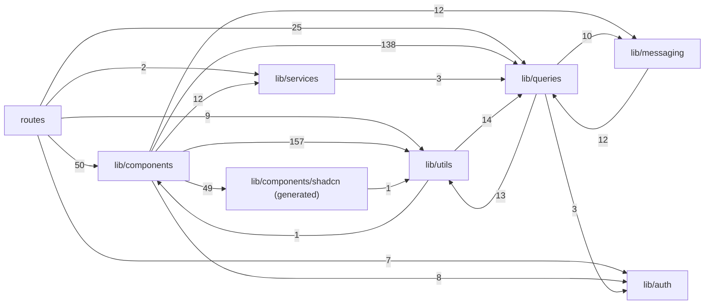

# AI-coding workflow trial: frontend (SvelteKit / TypeScript) log

- Worked on a local branch `ai-trial/frontend`, cut from `origin/main` at `92c03c5`. That branch is not pushed.
- Status: **Phases 0 to 5 are done.** This log covers Phases 0 to 4; the cross-track findings are in `docs/ai-trial-summary.md`.
- The guardrail code the trial built in Phases 2 and 3 (check script, hook, nested `CLAUDE.md`, ESLint rules and suppressions, `package.json` devDependencies) is **not part of this change**. It is kept as a patch against `92c03c5` in `docs/ai-trial-evidence/guardrails/frontend-phase2-3.patch` (without `pnpm-lock.yaml`), because `main` has since gained its own enforcement of the same ground (#862) and the two would collide. Paths named in this log, such as `frontend/scripts/check.sh` and `frontend/src/CLAUDE.md`, exist on the trial branch and in that patch, not on `main`.

How to read the evidence labels used below:

- **Re-run** = I re-ran the measurement myself after the discovery agent reported it, and it matched.
- **Agent-measured** = produced by the discovery agent's script (named), not independently re-run.
- **Inferred** = reasoning, not a measurement.

## Phase 0: Architecture discovery

### 0.1 Architecture as it exists

**Stack (from `package.json` / lockfile):** Svelte 5.57.3, SvelteKit 3.2.0, Vite 8.3.8, Vitest 4.1.12, TypeScript 6.0.3 plus `@typescript/native` 7.0.2 (alias of `typescript@7`). `check` = `svelte-kit sync && svelte-check --tsconfig ./tsconfig.json --tsgo`. SPA (`ssr = false`). Single package: `pnpm-workspace.yaml` holds only pnpm settings. 363 `src` files (`.ts` + `.svelte`), 315 test files.

**There is no ESLint and no lint step in CI.** Prettier is configured (`format:check` script) but no workflow runs it. (Re-run: the only ESLint configs in the tree are inside `node_modules`.)

**Entry points:** `src/app.html`; `routes/+layout.ts` (`ssr = false`); `routes/+layout.svelte` (root; imports svelte-clerk, the `queryClient` singleton, svelte-sonner; renders nothing until `ClerkLoaded` outside demo mode); three load files (`routes/+page.ts`, `routes/content-library/+page.ts`, `routes/discover/+page.ts`); `vite.config.ts` (Kit 3 has no `svelte.config.js`); `src/env.ts`.

**Where each concern lives:**

| Concern | Location |
|---|---|
| GraphQL transport | `lib/queries/client.ts`: `graphqlClient`, `graphqlRequest`, `graphqlRequestAnonymous`, the `queryClient` singleton (`client.ts:26`), default `staleTime` 60 s (`client.ts:30`, re-run; `frontend/CLAUDE.md` says the default is 0) |
| Realtime | `lib/messaging/ws-client.svelte.ts` (only `graphql-ws` importer) |
| TanStack Query | 84 files import it: 61 in `lib/queries`, 17 components, 4 `lib/messaging`, 2 routes |
| Query keys | `lib/queries/keys.ts` (`queryKeys`); the factory has no `me` key |
| Hooks and gql documents | `lib/queries/<domain>/index.ts` (gql) plus one `use<Verb><Noun>.ts` per hook: 8 domain folders, 59 hook files |
| Auth | `svelte-clerk` imported by exactly 5 files (re-run): `lib/auth/useAuthState.ts`, `components/auth/{AuthShow,SignInTrigger,UserMenu}.svelte`, `routes/+layout.svelte`. Demo flag `lib/auth/demo.svelte.ts:11` |
| Env reads | `import.meta.env.*` 17 times in 7 files. The GraphQL URL default is repeated at `client.ts:8`, `ws-client.svelte.ts:15`, `routes/+layout.svelte:49` |
| Rune modules | 16 `*.svelte.ts` files |
| Non-GraphQL network | only `utils/versionInfo.ts:42` (an injected default `fetch`) |
| AG Grid | `ag-grid-svelte5` in 3 components; `@ag-grid-community/*` in 9 files; `ag-grid-community` not installed |
| shadcn | `lib/components/shadcn` (generated, 41 files), imported by 55 files |

**Folder-level dependency graph** (generated by dependency-cruiser 17.4.3; edge labels are file-level import counts; `.svelte` `import type` edges that dependency-cruiser drops were recovered by an independent regex extractor and merged, 58 edges; the cross-check found 0 edges present only in dependency-cruiser):

Graph completeness: dependency-cruiser parsed 363 of 363 `src` files. 39 imports are unresolved, all virtual (37 `$app/*`, 2 type-only `./$types`); 0 unresolved `#lib` or relative imports. 1046 file-level edges, 164 folder-level edges. The Mermaid above omits the small folders (`theme`, `fonts`, `onboarding`, `contribute`, `stores`, `data`); the full matrix is in the scratchpad (see Evidence index).

Direction contradictions visible in the graph: `lib/queries` and `lib/messaging` import each other (folder cycle); `lib/utils` imports `lib/queries` (14, all type-only) and one component; `lib/messaging` and `lib/services` act as shadow data layers beside `lib/queries`. `lib` never imports `routes` (0 edges).

**Import cycles:** 12 elementary cycles in 3 strongly connected components when type imports count; 3 value-only cycles, each a 2-file loop: `utils/bookFormatting.ts` <-> `utils/formatting.ts`; `utils/plan-grid-config.ts` <-> `utils/planItemCellRenderer.ts`; `shadcn/dialog/dialog-content.svelte` <-> `dialog/index.ts` (generated). A 7-file group (`queries/content/{index,activityList}` plus 5 `utils` files) closes only through `import type`. (Agent-measured, `measure-7-layering-and-cycles.mjs`.)

### 0.2 Implicit conventions and where they are already broken

All agent-measured unless marked.

1. **gql documents live in `lib/queries/<domain>/index.ts`, one `use<Verb><Noun>.ts` hook per file** (e.g. `useCreatePerspective.ts:85`). Broken by 3 service files that carry their own gql (`services/tmdbApi.ts:12`) and `content/claims.ts`.
2. **UI imports hooks by deep file path** (85 import sites vs 48 through the domain `index.ts`; e.g. `PerspectivePopover.svelte:29-36`). Hooks are deliberately not re-exported from the index, so the documented "import the domain, not its guts" rule cannot be enforced as written.
3. **Mutation hooks own the toast and the cache eviction.** 39 mutation-hook files: 36 touch the cache, 23 toast, 26 have `onError` (e.g. `useCreatePerspective.ts:121,126`). 3 write no cache: `useStageImportFromFile`, `useSetTyping`, `useSetOnboardingDisplayNextSession`.
4. **Keys come from `queryKeys`.** Broken at `useMe.svelte.ts:18`, `AuthUserSync.svelte:14`, `useMarkOnboardingSeen.ts:8` (the same literal `['me', …]` in three files), plus `OnboardingCoach.svelte:61` and `OnboardingShell.svelte:49` (factory prefix plus a literal). Re-run: exactly these 5 inline `queryKey: [` sites.
5. **Explicit `staleTime`:** 35 of 39 `createQuery` calls set one. Misses: `Compare.svelte:63,75`, `useContentAggregates.ts:19`, `routes/discover/+page.svelte:149`.
6. **Auth through the facade.** No breaks (re-run: 5 files, all allowlisted).
7. **Runes only.** 0 plain `.ts` files with runes, 0 Svelte 4 syntax in `src`.
8. **`#lib/...` imports carry a suffix** (`.js`, `.svelte`, `.svelte.js`): 696 of 711; the 10 deviations are all in the charts feature (e.g. `ColumnChart.svelte:2,13,14,28`).
9. **shadcn through the barrel:** 53 of 55 files. Breaks: `charts/ColumnChartPopover.svelte:3`, `messaging/MessageLink.svelte:4`.
10. **Tests:** reach `src/lib` through `#lib` (675 specifiers in 290 of 315 files); 87 `vi.mock` calls target hook modules and 69 target `queries/client`; 19 files use `tests/helpers/queryBudget.ts`.

### 0.3 Candidate architecture rules (ranked)

Every cost-(a) rule below needs the one-time ESLint bootstrap (see 0.4). Rank is my judgement of value (how likely an agent is to break it times how costly the break is), not violation count.

Cost scale: **(a)** pure config in a mainstream tool; **(b)** needs a custom lint rule or script; **(c)** not statically checkable.

| # | Rule | Violations today (src / tests) | Cost | Who breaks it |
|---|---|---|---|---|
| F1 | UI builds no queries and calls no cache methods; it uses `useX` hooks | 18 of 142 UI files import `createQuery` (17) or `useQueryClient` (8); 10 cache-call sites in 9 files / tests: 0, 41 legitimate real-client cache calls | (a) `no-restricted-imports` with `importNames`; the cache-call selector is heuristic | AI: copies the nearest `createQuery` |
| F2 | UI never touches the GraphQL transport (`graphqlRequest`, `graphqlRequestAnonymous`, `graphqlClient`) | 15 files: 11 components, `routes/discover/+page.svelte:14`, 3 `lib/services` files / tests: 9 hits in 7 files (mocks, informational) | (a) ESLint `importNames`. dependency-cruiser over-reports (module-level, cannot see named bindings) | AI: inlines the shortest path; 12 of the 15 files also break F1, so ship F1 and F2 together |
| F3 | Use `isPending`, not `isLoading` | 9 reads in 6 files / tests: 11 hits in 4 files (mock objects) | (a) `no-restricted-syntax` selector | AI: older-docs prior |
| F4 | No raw hex/rgb colours in UI code | 6 lines in 2 files in the pre-commit hook's scope, 2 lines outside it (`activityItemCellRenderer.ts:282,350`); 224 theme-definition lines should be exempt / tests not scanned | (a) regex selector on literals (inferred, not run); honouring `hex-ok:` is (b) | AI: cloud sessions have no pre-commit hook |
| F5 | `svelte-clerk` only in the auth facade | 0 / 0 | (a) `no-restricted-imports` with an allowlist | AI. Blast radius is high: `demo-e2e` runs only on demo-path changes and unit tests mock `svelte-clerk`, so a violation could merge green |
| F6 | Query keys come from `queryKeys`; no root- or domain-wide eviction | 5 inline keys in 5 files; 0 root evictions; 1 domain-level eviction (`messaging/streamIdle.svelte.ts:30`) / tests: 6 inline keys in 5 files (informational) | (a) for literals and `.all()`; "key mirrors every variable" is (c) | both |
| F7 | No import cycles | 3 value cycles (2 real, 1 generated shadcn), 12 counting type imports / tests: 0 | (a) dependency-cruiser `no-circular`; use `viaOnly` for value-only. Needs a baseline for the generated shadcn cycle | both (invisible in a local diff) |
| F8 | Layer direction: `lib` never imports `routes`; non-component `lib` never imports components; shadcn self-contained; `utils` does not import queries by value | (a) 0, (b) 1 (`utils/tooltipHover.ts:1`, type-only), (c) 1 (generated `shadcn/input/input.svelte`), (d) 0 (14 type-only) | (a) dependency-cruiser `forbidden`, or ESLint per-folder `no-restricted-imports` | AI |

Evidence status: F1, F2, F3, F5, F6 counts **re-run** (grep). F4, F7, F8 **agent-measured** (F8's folder edges also match the graph matrix I read). Scripts: see Evidence index.

**Dropped or optional:** `ag-grid-community` imports (pnpm strictness already blocks it); runes in plain `.ts` and the `createQuery` thunk form (the build and types already enforce them); domain-index-only imports (not enforceable as written); Svelte 4 syntax (0 violations today, optional cheap guard); shadcn barrel (2 src, 0 tests); single GraphQL URL default (3 copies); explicit `staleTime` (4 real misses plus 1 false positive, cost (b)).

### 0.4 Tool comparison and recommendation

Smoke tests were run in the scratchpad against this worktree (nothing installed in it, nothing committed).

| Tool | Parses `.svelte` | Resolves `#lib` | Result on "components must not import the GraphQL client" | Baseline |
|---|---|---|---|---|
| ESLint 9.39.5 + `svelte-eslint-parser` 1.11.0 | yes, 0 parse errors on all 363 src + 315 test files | alias matched as a string pattern | exact: 18 hits (15 UI + 3 inside `lib/queries` the smoke did not exclude); re-run, matches | **ESLint bulk suppressions**, tested below |
| eslint-plugin-boundaries 7.4.4 | via the ESLint parser | needs `eslint-import-resolver-typescript` | 12 hits (file-level) | none of its own; ESLint suppressions apply, tested below |
| dependency-cruiser 17.4.3 | yes, but drops `import type` in `.svelte` | yes | file-level, over-reports (cannot see named bindings) | **native** `--baseline` / `--ignore-known`, `.dependency-cruiser-known-violations.json` (documented) |
| ArchUnitTS 2.5.5 | **no** | n/a | 0 hits, a false negative | not documented |
| madge 8.0.0 | **no** | n/a | n/a (also reports 2 cycles inside `.svelte-kit/types`) | none |

**Recommendation: ESLint (flat config) as the single tool**, with `no-restricted-imports` (`importNames`), `no-restricted-syntax` selectors and, where useful, eslint-plugin-boundaries. Reasons:

1. The highest-value rules (F1, F2, F5) are about **named bindings** (`graphqlRequest` vs `queryClient`, both exported from the same module). Only ESLint sees bindings. dependency-cruiser sees module edges, so a rule on `client.ts` would also flag the legitimate `queryClient` imports.
2. It is the only candidate that handles `.svelte` completely and also expresses syntax-level rules (F3, F4).
3. The baseline works, and I tested it (next section).

Add dependency-cruiser only if you select F7 or F8; it has its own native baseline and covers cycles, which ESLint does not.

Costs and risks to be aware of (all inferred except where stated):

- **Bootstrapping from zero.** Unlike Go, where the tools are standalone `go install` binaries, this adds devDependencies to `frontend/package.json` and `pnpm-lock.yaml` (`eslint`, `svelte-eslint-parser`, `@typescript-eslint/parser`; optionally `eslint-plugin-boundaries` and `eslint-import-resolver-typescript`) and a CI step. The repo has no ESLint today.
- **`ColorWheel.svelte:14,31`** carry `eslint-disable-next-line @typescript-eslint/no-explicit-any`; a config that does not load that plugin reports "definition for rule not found" for them (seen in my run, 2 messages).
- **TypeScript 7 alias:** `@typescript-eslint/parser` was exercised against TS 6.0.3 (the alias `typescript` stays on 6.x). Compatibility with the `@typescript/native` 7 alias is untested.
- eslint-plugin-boundaries 7.x prints a deprecation warning for `mode: 'file'`; drop `mode` in the real config.
- dependency-cruiser's docs say `.svelte` support uses the `svelte` compiler "(version 4.x)"; version 17.4.3 parsed Svelte 5 files here, but silently drops type imports in them.

#### Baseline test results (ESLint bulk suppressions)

The doc left two things open: whether suppressions cover plugin rules, and what a baseline does on new/fixed violations. I tested on a scratch copy of `frontend/src` (real files, `--suppress-all`, default `eslint-suppressions.json` in the copy):

| Scenario | Observed |
|---|---|
| Baseline everything (core + plugin rules) | 23 files; `no-restricted-imports` 18, `boundaries/dependencies` 12 (**plugin rule works**), `no-restricted-syntax` 9, `@typescript-eslint/no-explicit-any` 2 |
| Re-run with baseline | clean, exit 0 |
| New violation in a file with no baseline entry | exit 1, only the new violation reported (both rules fire) |
| Second violation of the same rule in a file that already had one baselined | exit 1; **all violations of that rule in that file are re-reported (old and new)**; rules whose count did not change stay suppressed |
| Add a line at the top of a baselined file (line numbers shift) | still suppressed: the baseline is keyed by file + rule + count, not line |
| Fix a baselined violation without pruning | **exit 2**, "There are suppressions left that do not occur anymore. Consider re-running the command with `--prune-suppressions`" |
| Lint via `--stdin` | suppressions are **not applied** (an unmodified file fails too). My first two stdin tests were invalid for this reason and are discarded |

Consequences for Phase 3 (inferred where marked):

- Count-based, so fixing one violation and adding another of the same rule in the same file nets out undetected (inferred, not tested). A moved or renamed file re-surfaces its violations (inferred).
- A fix makes the build red until `--prune-suppressions` shrinks the baseline, or `--pass-on-unpruned-suppressions` is used. So "baseline file is off-limits" must mean **it may shrink, never grow**; a guard comparing entry counts against `origin/main` is a cheap way to enforce that. Raise this as a design choice at the Phase 3 gate.

### 0.5 Java / ArchUnit equivalents (for mapping to the work codebase)

| Rule | ArchUnit shape |
|---|---|
| F1 / F2 UI must not use the data layer | `noClasses().that().resideInAPackage("..ui..").should().dependOnClassesThat().resideInAnyPackage("..infrastructure..", "..client..")`. ArchUnit sees dependencies per class, not per module, so it has the named-binding precision that dependency-cruiser lacks. |
| F3 `isPending` not `isLoading` (framework API misuse) | `noClasses().should().callMethod(SomeApi.class, "deprecatedMethod")`, or the `forbidden-apis` Maven/Gradle plugin with a signatures file. |
| F4 no raw colour literals | No ArchUnit equivalent (it reads bytecode, not literals). Checkstyle / regex or a SonarQube rule. The Java analogue is "no hard-coded config strings". |
| F5 third-party SDK confined to one facade package | `noClasses().that().resideOutsideOfPackage("..auth..").should().dependOnClassesThat().resideInAPackage("com.vendor.sdk..")`. Same shape as the Go gorm-confinement rule. |
| F6 keys from a factory | String-literal arguments are not visible to ArchUnit. Use Error Prone, Checkstyle or a custom `ArchCondition` on constructor calls. |
| F7 no cycles | `slices().matching("com.acme.(*)..").should().beFreeOfCycles()`: the canonical ArchUnit rule. |
| F8 layer direction | `layeredArchitecture().consideringOnlyDependenciesInLayers().layer("Routes").definedBy(...)...whereLayer("Routes").mayNotBeAccessedByAnyLayer()` (or `Architectures.onionArchitecture()`). |
| Baseline | `FreezingArchRule.freeze(rule)`: stores violations in a text-file `ViolationStore` (`freeze.store.default.path`); first run records, later runs fail only on new violations, and fixed violations are removed automatically. Keyed on violation text with line numbers ignored by default, which avoids the count-swap weakness ESLint has. |

### 0.6 Surprises relative to the repo's own docs

1. "Components call a hook, never `graphqlClient.request` inline" is broken by 15 files (re-run).
2. Hooks are not exported from the domain `index.ts`, so "import the domain, not its guts" cannot be enforced as written.
3. `frontend/CLAUDE.md` says the default `staleTime` is 0; the code sets 60 s (`client.ts:30`, re-run).
4. `frontend/STRUCTURE.md` is stale (agent-reported; I did not diff it).
5. `lib/messaging` and `lib/services` are shadow data layers; the key `['me', …]` is duplicated across three files because the factory lacks it.
6. The pre-commit colour guard is local-only, covers added lines only, and has narrow scope; absent in cloud checkouts.
7. `demo-e2e` runs only on demo-file changes; CI runs svelte-check, tests with coverage thresholds (80/75/75/80), and browser tests, but no lint.

### Evidence index (scratchpad; ephemeral)

`/tmp/claude-0/-home-user-perspectize/b4e8a1bc-45a6-543a-9d0b-379630c02c02/scratchpad/phase0/frontend/`: `edges.tsv`, `edges-file.tsv`, `matrix-layer.md`/`.tsv`, `graph-layer.mmd`, `graph-module.mmd`, `cycles.txt`, `measure-*.mjs` with `.out` files, `tools/smoke-eslint.config.mjs`, `smoke-*.out`, and my baseline test copy in `fe-copy/` (+ `tools/copy-eslint.config.mjs`). These live in the container's scratchpad and are lost when it is reclaimed, unless you ask me to vendor the scripts into the repo.

## Phase 1: Baseline measurement (SvelteKit / TypeScript)

### 1.1 Method

Five frontend tasks, each taken from a past commit and attempted twice. **A** = the ticket alone. **B** = the ticket plus the key files and the interfaces the real fix introduced. Condition C was dropped at the user's request. Each attempt is a fresh general-purpose subagent in a numbered worktree slot, checked out at the commit's **parent**, with `pnpm install --frozen-lockfile` run first, a prompt rule against reading git history (the clone is shallow, 50 commits), and the repo's `CLAUDE.md` files visible to it.

Scoring, per attempt: `pnpm run check` (svelte-check with `--tsgo`); the repo's full Vitest suite including the agent's own tests; the **real commit's tests overlaid** on the attempt ("hidden tests"); and a "would accept" judgement on the diff. Hidden-test failures are split into **name, path or hook mismatches** (something the ticket did not name), **copy-text mismatches** and **behaviour divergences**. To separate them I used temporary adapters, aliases or one-attribute shims, always backed up first and restored byte-identical (checked with `cmp`). Cost (tool calls, tokens, seconds) is from each agent's completion notice.

Evidence: hidden-test runs are mine. Full-suite runs for T5, T7, T8 and T9 are mine, with saved logs; T6's full-suite numbers are the agent's own report. The B hints were written from the real commit, so B is the best case for a key-files hint. One run per cell, no repeats: differences of about 10% in cost, or a single pass or fail, are not established.

### 1.2 Results

| Task | Cond | Real tests load? | Hidden result | Would accept | Calls | Tokens | Secs |
|---|---|---|---|---|---|---|---|
| T5 keep row order across refetch (`6d227da1`) | A | no: real test imports `createRowOrderMemory` from `$lib/utils/rowOrder`, A built a `DisplayedOrder` class elsewhere | with a 6-line adapter: 6 of 6 | yes | 79 | 210,752 | 527 |
| T5 | B | yes (hint named the path and exports) | 6 of 6 fail on `memory.apply is not a function` (B: `arrange`, `reset`); with an alias: 6 of 6 | yes | 42 | 150,569 | 483 |
| T6 BSB omitted verses (`af2aa79f`) | A | yes | 15 of 16; 1 fails on copy (`omits this verse`, link `read it on bible gateway`) | yes | 49 | 158,873 | 316 |
| T6 | B | yes | 15 of 16, the same copy failure | yes | 27 | 129,676 | 194 |
| T7 type switches when one type shown (`8d89d811`) | A | no: `otherTypeOptionsWhenOne` and `TypePills.svelte` do not exist (A: `otherTypeSwitches`, inline markup) | unit 5 of 5 with a one-line adapter; the 4 component cases cannot be separated | yes | 58 | 176,708 | 439 |
| T7 | B | yes | unit 5 of 5; component 4 of 4 fail (props `options` vs real `filters` + `onSelect`; labels "Movie" vs "Show only Movie") | yes | 60 | 176,738 | 468 |
| T8 Plan grid header floor (`f90309ae`) | A | yes | 48 of 48 | yes | 46 | 151,996 | 313 |
| T8 | B | yes | 48 of 48 | yes | 57 | 166,887 | 456 |
| T9 claim icon in card list and modal (`92c03c5f`) | A | yes | 102 of 104; both failures are the hook `[data-icon="claim"]`; 104 of 104 with it added | yes | 36 | 158,001 | 371 |
| T9 | B | yes | the same; 104 of 104 with the hook | yes | 38 | 152,556 | 257 |

Typecheck was clean for all ten attempts (T8-B after the stale-cache fix in 1.3); the full suite passed for all ten.

Frontend totals, A then B: real tests load 3 of 5 vs 5 of 5; all real tests pass as delivered 1 of 5 vs 1 of 5 (T8); tool calls 268 vs 224; tokens 856,330 vs 776,426 (B -9.3%); seconds 1,966 vs 1,858.

### 1.3 What each task showed

- **T5.** The hint carried the module path and two of the three exports, so the real test loads for B and not for A. It did not carry the memory's method name, so every real case still fails for B until aliased. With names aside, both match the real behaviour. B was cheaper (42 calls against 79, 150k tokens against 211k). B integrates like the real commit (`$derived`, keyed on `hashKey(activityRequest.queryKey)`, placeholder flag); A records in an `$effect` instead, deliberately, with a comment explaining a key-change window I did not try to reproduce. A added 33 tests where the real commit has 6.
- **T6.** Same single copy failure in both. B stayed inside `PassageText.svelte` as hinted; A built a new `OmittedVerse` component and also changed the interlinear view (small scope growth). B was cheaper (27 calls against 49).
- **T7.** A one-sentence ticket, so the real test surface was unguessable for A. The hint made the unit surface compile and pass but did not carry the component's props or button names, so half the real tests still fail. Cost was equal. B also found, through its own page test, that a Cast/Director scope lingered after leaving Movie, and fixed it beyond the ticket; A made the same fix.
- **T8.** The one task both conditions passed with no failures. The ticket named both columns, both widths and "the same floor the Activity grid uses", and `frontend/CLAUDE.md` already describes that mechanism (`headerMinWidth`, `headerChrome`), which is what A reused. So part of A's result is the repo's own docs doing the hint's job. B cost more (57 calls against 46) for the same result and edited `frontend/CLAUDE.md`, `docs/AG_GRID.md` and added a component test, all accurate and unrequested.
- **T9.** Both conditions built the same design and failed only on a test hook the ticket never mentions; the repo's only `data-icon` is `bible-passage` on inline SVG strings, so inferring `data-icon="claim"` was a stretch. A used `text-primary`, `size-10`; B used `text-muted-foreground`, `size-8`; the real commit used `text-primary`, `size-8`. Both dropped the modal's grey tile for claims; the real commit kept it, and the real tests do not check it.
- **Harness hazard (found in T8-B).** svelte-check keeps a generated copy of every `.svelte` file it has seen in a slot, gitignored, in `.svelte-kit/.svelte-check`. A slot reused across checkouts can fail the check at a commit that has no such file (here a stale `++TypePills.svelte.ts` from T7). I deleted that one generated file and the prep script now clears the cache; no other attempt was affected. A real repo with reused worktrees would hit the same thing.

### 1.4 Reading for this track

- **Names, paths, test hooks and copy decided whether the real tests passed.** Of 10 attempts, 6 failed first on a name, path, prop or hook the ticket never gave (T5 A and B, T7 A and B, T9 A and B), 2 on copy text (T6), and 2 passed cleanly (T8). The hint closed the compile-level part (loads for 5 of 5 instead of 3 of 5) and not the rest.
- **Concrete tickets mattered more than the hint.** T8's ticket named the artefact, the values and the existing mechanism, and both conditions passed. T7's one sentence did not, and both conditions failed its component tests.
- **Cost:** B was cheaper on this track (-9.3% tokens, -16% calls), mostly from T5 and T6. B was costlier on T8. One run per cell, so I would not read it as an effect.

### 1.5 Caveats specific to this track

No browser or visual check was possible (cloud session, no Clerk sign-in), by me or by any agent: nothing was seen rendered (T8's column widths were computed in tests, T9's icon colour was never viewed). AG Grid does not render in jsdom, so the grid tests exercise the config and helpers, not a rendered grid. Hidden tests are one valid design, not the only one.

### Phase 1 evidence index (scratchpad; ephemeral)

`/tmp/claude-0/-home-user-perspectize/b4e8a1bc-45a6-543a-9d0b-379630c02c02/scratchpad/phase1/`: `results.md` (full per-attempt notes), `report.md` (both tracks), `tasks.md` (ticket A and B texts), `attempts/T{5..9}-{A,B}.patch` (each attempt's diff) and `T{5,7,8,9}-*-fullsuite.log`, the `prep`/`gen-prompt`/`snapshot`/`hidden`/`reset` scripts. Lost when the container is reclaimed unless vendored into the repo.

## Phase 2: Feedback loop and guidance (SvelteKit / TypeScript)

### 2.1 What was built

| File | Purpose |
|---|---|
| `frontend/scripts/check.sh` | One entry point with three tiers: `fast <file>...`, `step`, `full` |
| `.claude/hooks/fast-check.sh` | PostToolUse hook: runs the `fast` tier of the track that owns the edited file (identical on both trial branches) |
| `.claude/settings.json` | One added entry: `PostToolUse`, matcher `Edit\|Write\|MultiEdit`, runs the hook, 90 s timeout |
| `frontend/src/CLAUDE.md` | Lean nested guidance, 70 lines, loaded when working under `frontend/src/` |
| `docs/ticket-template-frontend.md` | Ticket template (2.6) |

Nothing is committed. No new dependency and no change to `package.json` or the lockfile: the script uses the repo's own `prettier`, `svelte-check` and `vitest`, plus `perl`, `bc` and `jq`.

### 2.2 Check tiers (measured here)

| Tier | When | What it runs | Time |
|---|---|---|---|
| `fast` | after every edit (the hook) | `prettier --check` on the edited file, then `svelte-check` (`--tsgo`) for the whole project | about 7 s |
| `step` | after each logical step | prettier on every changed file, `svelte-check` with a fresh generated cache, `vitest related` on the changed `src` and `tests` files | 22.6 s for a leaf utility (10 related test files, 247 tests); 41.9 s for a file most of the app imports (43 test files, 794 tests) |
| `full` | before pushing | prettier on changed files, `svelte-check` with a fresh cache, the whole `unit` project | 122.9 s on a clean tree (286 test files, 4,118 tests, all passing) |

"Changed" means committed since `origin/main`, uncommitted, or untracked. Output on success is two lines (status and time, then the test counts); on failure it is the findings only, capped at 40 lines per section.

Design choices:

- **Report only, no auto-fix.** The hook has no side effects on the file the agent is editing.
- **`svelte-check` runs for the whole project even on `fast`**, because a type change in one file breaks others and the cost (about 7 s) is the same either way. The script says when errors are in files the agent did not just edit.
- **Stale generated cache.** `step` and `full` clear `.svelte-kit/.svelte-check` first (the Phase 1 hazard). `fast` does not, to stay fast.
- **A lock per checkout** (a `mkdir` lock in the temp directory), because the hook can fire for several edits at once and `svelte-check` writes into `.svelte-kit`.
- **Only the `unit` Vitest project runs.** Browser Mode tests (`tests/browser`) run in CI, not here. Nothing renders in a cloud session, so nothing in this loop looks at a page.
- The script stops with install instructions if `frontend/node_modules` is missing.
- Written for macOS's bash 3.2 and BSD tools. **Tested only on bash 5 and Linux.**

I exercised `fast` and `step` with temporary probe files (`zzProbe.ts`, `tests/unit/zzProbe.test.ts`) and a one-line change to `gridUrlState.ts`, all reverted; for the leaf-utility timing above I appended a comment to `grid-header-width.ts` and reverted it. `git status` in this worktree shows only the Phase 2 files.

### 2.3 The PostToolUse hook

The hook file and settings entry are identical to the backend's (`cmp` shows no difference). The same points apply:

- Exit code 2 with text on stderr is the only way a PostToolUse hook's output reaches the model; exit 0 does not. So it is silent on success.
- It takes the checkout from the edited file's own git root, and skips files outside `backend/` and `frontend/`, or a track whose `check.sh` does not exist in that checkout.
- I verified it by piping sample hook input to it (shown on the backend side: pass, fail and skip cases). **It has not fired live in this session.**
- The open question for Phase 4 (does a subagent in another checkout load that checkout's `settings.json`?) is described in the backend log, 2.3. My default is that the Phase 4 `CLAUDE.md` loop tells the agent to run `check.sh step` itself.

### 2.4 Code intelligence

- Claude Code gets code intelligence from LSP plugins (`typescript-lsp` for TypeScript; no official Svelte plugin). **Cloud sessions do not start plugin language servers, so there is no LSP tool in this session.** I could not test what an agent would do with one.
- What I did instead: installed `typescript-language-server` 6.1.0, `svelte-language-server` 0.18.6 and `typescript-svelte-plugin` 0.3.52 in the scratchpad, wrote a small LSP-over-stdio script, and asked each for find-references of `queryKeys` (`src/lib/queries/keys.ts:6`), against the project's own TypeScript 6.0.3.

| Setup | References | Files | In `.svelte` files |
|---|---|---|---|
| `typescript-language-server` alone | 495 | 90 | 0 |
| `svelteserver` alone, asked about the `.ts` symbol | 0 (empty answer) | 0 | 0 |
| `typescript-language-server` + `typescript-svelte-plugin` (how the VS Code Svelte extension does it) | 520 | 101 | 25 references in 11 files |

- Text search for the word in `src` and `tests` finds 104 files. All 101 files the language server found are among them (0 files only in the language server). The 3 files only in text search use the word in a comment or a test name (I read all three lines). The 11 `.svelte` files match the 11 `.svelte` files text search finds in `src`.
- So a TypeScript server alone misses every use inside a `.svelte` file, and the Svelte language server on its own returned an empty answer for a symbol declared in a `.ts` file (I did not look into why; my guess is that it leaves `.ts` files to the TypeScript server). Only the TypeScript server with the Svelte plugin gave the complete list. A local Claude Code setup would need a custom plugin (`.lsp.json`) wiring `typescript-language-server` with that plugin, since no official Svelte one exists. I did not build or test that plugin.
- What this does and does not show: a correct reference list is available from the tooling for this codebase and matches text search apart from comments. It does not show that an agent uses it, or that using it helps.

### 2.5 Nested `CLAUDE.md`

`frontend/src/CLAUDE.md` (70 lines) holds: the check commands and their limits; "names are part of the contract" (Phase 1: 6 of 10 attempts failed first on a name, path, prop or test hook the ticket never gave, 2 on copy); where things go (hooks, keys, auth facade, imports, shadcn barrel); test rules; the existing layer breaks listed as "not precedent"; and the docs that are out of date (`staleTime` default is 60 s, "import the domain" cannot be followed as written). It does not repeat `frontend/CLAUDE.md`.

It sits under `src/`, so it loads when the agent works on source files and not when it only touches `tests/`; the test rules in it are therefore read only if the agent has also opened `src`. For a task that edits only tests this is a gap.

### 2.6 Ticket template

`docs/ticket-template-frontend.md`. Fields: behaviour, where it goes (file:line, the sibling to copy, the existing mechanism to reuse, and for data fetching the hook, key, `staleTime` and eviction), names the tests will use (module path, exports, props, test hooks, accessible names, visible text), open decisions with a default, out of scope, verify (including what cannot be seen here), report back. A table at the end maps each field to the Phase 1 failure it closes. The template is untested: Phase 4 is its first use.

### 2.7 Not verified, open

- Not run on macOS or bash 3.2.
- The hook has not fired live; subagent reach is the open question.
- Nothing in this loop looks at a rendered page.
- Whether an agent given the nested `CLAUDE.md` and the check loop behaves better is what Phase 4 measures. Nothing in Phase 2 shows it.
- The nested `CLAUDE.md` does not load for test-only work (2.5).

### Phase 2 evidence index (scratchpad; ephemeral)

`/tmp/claude-0/-home-user-perspectize/b4e8a1bc-45a6-543a-9d0b-379630c02c02/scratchpad/phase2/`: `time-frontend.sh` (timing script), `lsp/lsp-refs.mjs` (the LSP client), `lsp/ts-refs-queryKeys.txt`, `lsp/svelte-refs-queryKeys.txt`, `lsp/tssvelte-refs-queryKeys.txt`, `lsp/ls-files.txt`, `lsp/grep-files-queryKeys.txt`. Lost when the container is reclaimed unless vendored into the repo.

## Phase 3: Architecture rules as checks (SvelteKit / TypeScript)

Rules F1, F2, F5 and F6, enforced by ESLint, with the violations that already exist recorded so that only a new one fails.

### 3.1 What was built

| File | Purpose |
|---|---|
| `frontend/eslint.config.js` (61 lines) | Which rule applies where; switches inline `eslint-disable` comments off |
| `frontend/eslint-rules/arch.js` (126 lines) | Four local ESLint rules, one per architecture rule (3.3) |
| `frontend/eslint-suppressions.json` | The baseline: 34 tolerated violations, in ESLint's own bulk-suppression format |
| `frontend/scripts/arch-check.sh` (148 lines) | `check` (default), `shrink`, `init`; adds the never-grow guard (3.4) |
| `frontend/scripts/check.sh` | Runs `arch-check.sh` in the `step` and `full` tiers |
| `frontend/src/CLAUDE.md` | 85 lines (was 70): the rules, the off-limits files, corrected counts |
| `frontend/.prettierignore` | One line: `eslint-suppressions.json` (ESLint rewrites it in its own format) |
| `frontend/package.json`, `frontend/pnpm-lock.yaml` | Three devDependencies (3.2) |

Nothing is committed. No `lint` script was added to `package.json`, and ESLint is not wired into CI: the check runs through `scripts/arch-check.sh` only.

### 3.2 Dependencies, and why ESLint 9 had to go

- Approved: `eslint` ^9.39.5, `svelte-eslint-parser` ^1.11.0, `@typescript-eslint/parser` ^8.73.0. Installed: `eslint` 10.15.0 (see below), `svelte-eslint-parser` 1.12.0, `@typescript-eslint/parser` 8.74.0. pnpm wrote the resolved versions into `package.json` as the range floor.
- **ESLint 9.39.5 does not start in this repo.** Every run died with `TypeError: expand is not a function`, thrown inside `minimatch@3.1.5` before any file was linted. Cause: `frontend/pnpm-workspace.yaml` overrides `brace-expansion` to `^5.0.12` for the whole dependency tree, and `minimatch@3` calls `require('brace-expansion')` as a function, which 1.x exports and 5.x does not.
- I reproduced it in a scratch project that copies the repo's `overrides` block (a), then tested two fixes there, each with a `.ts` and a `.svelte` file that must both be reported:

| Variant | Result |
|---|---|
| (a) ESLint 9.39.5, the repo's overrides | Same crash |
| (b) ESLint 9.39.5, plus `'minimatch@3>brace-expansion': ^1.1.12` | Works; resolved brace-expansion 1.1.22 for minimatch 3 only |
| (c) ESLint 10.0.0 range (resolved 10.15.0), the repo's overrides | Works; uses minimatch 11, no override change |

- You chose (c). I also ran the bulk-suppression flow on (c) in scratch before choosing: a baselined violation passes, a new one fails, a fixed one makes ESLint exit 2 with a prune instruction.
- ESLint 10 declares `node: ^20.19.0 || ^22.13.0 || >=24`; this session runs Node 22.23.5. **Not checked:** which advisory the `brace-expansion` override addresses (it is not in `.docs/DEPENDENCY_SECURITY.md`). I did not change any override.
- Lockfile, compared with `HEAD`: no package removed and no version of an existing package changed; 72 packages added (ESLint's tree); the only new direct dependencies are the three. `pnpm install --frozen-lockfile` passes. pnpm printed `-52`; since no package was removed, I read that as peer-suffixed variants of existing entries being renamed, which I did not look into further. pnpm also re-sorted the `@playwright/test` line in `package.json`; I put it back, so that diff is the three added lines.
- pnpm warns that `@typescript-eslint/parser`'s `typescript-estree` has an unmet peer on `@typescript/native` (found 7.0.2, wants a 7.1 pre-release). Parsing `.ts` and `.svelte` worked in every run here.
- **The whole unit suite still passes with the new packages:** `check.sh full` ran 286 test files and 4,118 tests, all passing.

### 3.3 The rules

| Rule | Flags | Applies to | Existing |
|---|---|---|---|
| F1 `arch/f1-ui-uses-hooks` | Importing `createQuery`, `createMutation`, `createInfiniteQuery` or `createQueries` from `@tanstack/svelte-query` | UI: `src/lib/components`, `src/routes` | 17 files (16 components, 1 route) |
| F2 `arch/f2-ui-no-graphql-transport` | Importing `graphqlRequest`, `graphqlRequestAnonymous` or `graphqlClient` from the queries client module, or anything from `graphql-request` or `graphql-ws` | UI | 12 files, all of them also F1 |
| F5 `arch/f5-clerk-only-in-auth-facade` | Any import of `svelte-clerk` | All of `src` except `lib/auth/useAuthState.ts`, `lib/components/auth/**`, `routes/+layout.svelte` | 0 |
| F6 `arch/f6-query-keys-from-factory` | An array literal (also inside `as const`) as a `queryKey` property, or as the first argument of `getQueryData`, `setQueryData` or `getQueryState` | All of `src` except `lib/queries/keys.ts` | 5 files |

Type-only imports are skipped; re-exports and dynamic `import()` of the same modules are caught. Tests are not linted (they live in `frontend/tests`, outside `src`).

**This differs from what I described when I asked for the dependencies.** I said the rules would use ESLint's built-in `no-restricted-imports` and `no-restricted-syntax`. They are four small local rules instead, with no new package. ESLint's suppression file counts violations per file and rule id; F1 and F2 would have shared the id `no-restricted-imports`, so fixing an F1 violation in a file and adding an F2 one there would leave the count unchanged and pass. I did not run that swap; it follows from how the file is keyed. Four ids close it.

### 3.4 Baseline and the never-grow guard

- `eslint src --suppress-all` wrote the baseline: per file and rule, how many violations are tolerated. 34 in total (F1 17, F2 12, F6 5, F5 0).
- ESLint has no never-grow check of its own: rerunning `--suppress-all` after adding a violation hides it. `arch-check.sh` compares each file and rule's count with the commit that added `eslint-suppressions.json` (or `ARCH_BASELINE_REF` when set) and fails if any is higher or new.
- `noInlineConfig: true` makes every `eslint-disable` comment do nothing. The cost: `ColorWheel.svelte` already has two `// eslint-disable-next-line @typescript-eslint/no-explicit-any` comments (for a rule this repo does not configure), and ESLint now warns about them. The wrapper counts errors only, so they do not fail the check.
- When a file gains a violation of a rule it already has baselined, ESLint reports all of that file's violations of the rule, not only the extra one. The wrapper's header says so; my first wording ("2 new") was wrong when only one was.

### 3.5 Red and green (what I ran)

All probes were removed or restored; `git status` in this worktree shows only the Phase 3 files (Phase 2 is committed), and `PassageText.svelte` is unchanged from `HEAD`.

| Probe | Result |
|---|---|
| Clean tree | `arch-check: OK (0 new; 34 known violations in the baseline)`, 5.9 s |
| One new component importing `createQuery`, `graphqlRequest`, `svelte-clerk` and writing `queryKey: ['zz', ...]`, with `// eslint-disable-next-line arch/f1-ui-uses-hooks` above the first import | F1, F2, F5 and F6 each reported; the disable comment had no effect |
| A `.ts` file with `setQueryData(['y'], 1)`, `getQueryData(['y'] as const)`, `{ queryKey: ['z'] as const }`, plus `getQueryData(queryKeys.content.all())` and `{ queryKey: queryKeys.content.lists() }` | The first three flagged (F6); the two `queryKeys` forms not flagged |
| A second `createMutation` import in `PassageText.svelte`, which has one F1 baselined | Fails (both F1 lines listed) |
| Delete the baselined `createQuery` import from `PassageText.svelte` | Fails: baseline entry no longer occurs, tells you to run `shrink`; `shrink` takes 34 to 33; check then passes. Restored from a backup afterwards |
| Throwaway repo with the baseline committed: unchanged | `OK`, no "not committed" note |
| Same, plant a violation and rerun `eslint --suppress-all` to hide it | Fails: `ZzProbe.svelte arch/f1-ui-uses-hooks: 1 tolerated, was 0` and the same for F6 |
| Same, raise one count by hand and add a matching second violation | ESLint itself passes; the wrapper fails: `PassageText.svelte arch/f1-ui-uses-hooks: 2 tolerated, was 1` |

F5 has no baseline entries. Its allowed set was checked by the clean run: the five files that import `svelte-clerk` (`useAuthState.ts`, the three in `components/auth/`, `+layout.svelte`) all pass, and the probe component outside that set fails.

### 3.6 Counts against Phase 2

| Item | Phase 2 said | Measured now |
|---|---|---|
| F6 inline keys | 5 files | 5 files, the same five |
| F2 transport callers | 15 files, 12 in the F1 group | 12 UI files, all in the F1 group; the other 3 are `lib/services` files, outside F2's scope |
| F1 builders | 18 of 142 UI files import `createQuery` | 17. A text search counted `AddContentPopover.svelte` (the word is only in comments) and `PerspectivePopover.svelte` (a local variable named `createMutation`) |
| `useQueryClient` in UI | 8 files | 8 files (not covered by any rule) |

`frontend/src/CLAUDE.md` is corrected to the measured figures.

### 3.7 Time

| Run | Time |
|---|---|
| `arch-check.sh` alone | 5.9 s |
| `check.sh step` with no related tests (config files only changed) | 13.6 s |
| `check.sh full` | 130.3 s (122.9 s before this phase), 286 files, 4,118 tests passing |

### 3.8 Not verified, open

- An agent can edit `eslint.config.js`, `eslint-rules/arch.js` and the baseline. Only the nested `CLAUDE.md` forbids it, and the growth check catches a grown baseline but not a weakened rule. Same gap as the backend.
- The growth check needs a baseline commit to compare with. In a fresh Phase 4 worktree the baseline must be in the base commit, or `ARCH_BASELINE_REF` must name one.
- A baseline entry for a file that has been deleted is not reported as stale: in the scratch project ESLint stayed silent (exit 0), because it only checks files it lints. If someone later recreates that path with a violation, the leftover entry tolerates it, though never above the original count. I did not test whether `shrink` removes such entries.
- Gaps by design: F2 does not cover the three `lib/services` files that call the transport; nothing covers `useQueryClient` in UI; F6 does not see a key built as a literal in a variable and passed in later.
- Not run on macOS or bash 3.2. ESLint 10 requires Node 20.19, 22.13 or 24 and above.
- No agent has used the check yet. Phase 4 measures that.

### Phase 3 evidence index (scratchpad; ephemeral)

`/tmp/claude-0/-home-user-perspectize/b4e8a1bc-45a6-543a-9d0b-379630c02c02/scratchpad/`: `eslint-compat/run.sh` and its three variants (`a-eslint9-repo-overrides`, `b-eslint9-scoped-override`, `c-eslint10`), `eslint-raw.json` (the first run with no baseline), `eslint-suppressions.json.orig` (the baseline), `fe-growth/` (the throwaway repo for the growth guard), `pkgs.before.txt` and `pkgs.after.txt` (resolved packages before and after). Lost when the container is reclaimed unless vendored into the repo.

## Phase 4: Closing the loop (SvelteKit / TypeScript)

### 4.1 What changed

Only the nested `frontend/src/CLAUDE.md` gained a section, **The loop** (after "Check your work"): make one logical change, run `bash frontend/scripts/check.sh step` and read all of its output, on red fix the code the failure names (call a `useX` hook instead of `createQuery`, take the key from `queryKeys`, go through the auth facade; when several violations of one rule are listed in a file that already had one, the new one is in `git diff`), on green take the next step (and run `arch-check.sh shrink` after fixing a baselined violation), and before reporting run `full` and quote its summary line and the `arch-check:` line. If the ticket cannot be done without breaking a rule or adding an exemption, the agent is told to stop and say so, and not to edit `eslint-suppressions.json`, `eslint.config.js` or `eslint-rules/`.

Scope is the one the user chose: **the `CLAUDE.md` loop only, no hook on the session branch.**

### 4.2 Method, and where it differs from Phase 1

Each of T5 to T9 was rerun under condition A (the ticket alone, same prompt and rules as Phase 1) by a fresh general-purpose subagent in a numbered worktree slot at the task's parent commit, plus **one scratch commit** laying the Phase 2 and 3 files on it (check scripts, the four ESLint rules, `eslint.config.js`, the nested `CLAUDE.md`, the ticket template, `package.json` and lockfile with the three ESLint devDependencies) and a baseline regenerated for that older code (34 violations at all five parents). Scratch commits are on branches `ai-trial/p4-<task>-A`, never pushed, deleted after scoring. Hidden tests are the real commit's test files overlaid, as in Phase 1; I re-ran `check.sh full` in each slot myself to confirm the agent's own tests and the arch-check.

Differences from the real set-up:

- **Two dependency generations.** T5 to T8's parents are on SvelteKit 2.70 and vite 7 with the `$lib` alias; T9's parent is on Kit 3, vite 8 and `#lib`. For T5 to T8 I took the Phase 3 `package.json` and a lockfile resolved against the older set (`--lockfile-only`) and rewrote `#lib` to `$lib` in the nested `CLAUDE.md`. The ESLint rules match package names and imported names, so they behave the same at both.
- **No hook ran** (a hook is session configuration; the scratch commit carries files). The nested file still says a hook runs `fast` after every edit, which was wrong for these runs.
- **`check.sh` diffs against `origin/main`**, which is newer than these parents, so overlay files count as "changed" there (harmless, but `step` formats and tests more files than the agent touched).
- **The run rules interfere with the script.** The Phase 1 prompt forbids "diffing against another commit" so an agent cannot read the upstream fix. `check.sh` runs `git diff origin/main...HEAD`. T9's agent set `CHECK_BASE=HEAD` to get around it; T8's agent did not run the script at all (4.4). In real use this rule does not exist; here it is an artifact of the experiment.
- One run per cell, so single passes, failures and differences of about 10% are not established. "Ran `check.sh`" is a count of matching commands in each agent's transcript: approximate.

### 4.3 Results

Phase 1 A figures in the last column.

| Task | Own tests (`check.sh full`, confirmed here) | Real tests | Would accept | Calls | Tokens | Secs | `check.sh` runs | Phase 1 A |
|---|---|---|---|---|---|---|---|---|
| T5 | OK, 270 files / 3,830 tests, arch-check OK (34 known) | no load: real test imports `createRowOrderMemory` from `$lib/utils/rowOrder`; attempt has `keepRowOrder(memo, {...})` in `queries/content/activityList.ts` | yes | 49 | 203,338 | 766 | step x4, full x2 | no load (`DisplayedOrder`); 79 calls, 210,752 tokens |
| T6 | OK, 268 files / 3,796 tests | 15 of 16; the failure is copy (`omits this verse`) | yes | 38 | 154,133 | 416 | step x4, full x2 | the same 15 of 16; 49 calls, 158,873 tokens |
| T7 | OK, 269 files / 3,813 tests | no load: `otherTypeOptionsWhenOne` and `TypePills.svelte` do not exist (attempt: `TypeSwitcher.svelte`, `typeSwitchOptions`) | yes, with a note | 55 | 189,983 | 611 | step x2, full x2 | no load; 58 calls, 176,708 tokens |
| T8 | OK, 267 files / 3,788 tests | 47 of 48; list mode: Priority heading minWidth 84, floor 103 | yes, with a note | 40 | 162,013 | 359 | none | 48 of 48; 46 calls, 151,996 tokens |
| T9 | OK, 286 files / 4,120 tests | 104 of 104 (the agent added `data-icon="claim"`) | yes | 41 | 179,927 | 455 | step and full, `CHECK_BASE=HEAD` | 102 of 104 (the hook); 36 calls, 158,001 tokens |

Totals, Phase 4 against Phase 1 A: real tests load **3 of 5 vs 3 of 5**; all real tests pass as delivered **1 of 5 vs 1 of 5** (T9 now, T8 then); tool calls 223 vs 268 (-17%); tokens 889,394 vs 856,330 (+3.9%); seconds 2,607 vs 1,966. Every end state had `arch-check` green with 0 new violations, and no agent touched `eslint-suppressions.json`, `eslint.config.js` or `eslint-rules/`.

### 4.4 What the reruns showed

- **Names, paths and hooks still decided the real tests.** T5 and T7 do not load, for a module path, an export or a component the ticket never named. T6 has the same single copy failure. The one pass-to-fail and the one fail-to-pass cancel (T8 lost list mode, T9 gained the hook), and I cannot attribute either to the guardrails.
- **T9 now has `data-icon="claim"`; Phase 1 A and B did not.** The nested file says to copy the nearest neighbour's pattern for a test hook and list what you chose. One run, so it could be chance.
- **T8 missed list mode of the heading floor** (Priority's minWidth is 84 where the real test needs 103); grid mode was right. Phase 1 passed 48 of 48 in both conditions. The ticket and the repo's docs are the same as before; I cannot say why this run differs.
- **T8 did not run `check.sh`.** Its agent read "no diffing against another commit" as covering the script and ran the pieces by hand instead: `vitest` on the touched tests, `prettier --check`, `arch-check.sh` (twice), `pnpm run check` and `pnpm run test:run`. The same gates ran, so the end state is as checked as in the other runs; only the loop's single entry point went unused. T9 used the script with `CHECK_BASE=HEAD`. T5 to T7 ran it, `step` two to four times and `full` twice each (approximate counts from the transcripts). See 4.2: this is partly an artifact of the experiment's own rule.
- **The red step fired once on ordinary code:** in T6, `check.sh step` failed on the agent's own new test, then passed. No end state had a new `arch-check` violation; I did not tally intermediate runs, so I cannot say whether any `step` went red on a rule on the way. The shortcut task below is the deliberate test of that.
- **A side effect of the gate (T5).** `step` runs prettier on every changed file, and `ActivityTable.svelte` already had one unformatted line at this parent (the Duration `headerTooltip`). The agent reformatted that unrelated line to get `step` green; Phase 1 A saw the same diff and left it alone. A formatter gate on whole files makes agents touch lines they were not asked to.
- **Cost:** tool calls fell 17% and tokens rose 3.9%, with the loop's `step` and `full` runs in the wall-clock time. One run per cell, so I would not read either as an effect.

### 4.5 Shortcut task: the "N of M felt" line in `PerspectivePopover.svelte`

The ticket asks for a line under the feel wheel for the first picked feeling, from the existing `feelingStats(contentID, emoji, label)` GraphQL query. There is no frontend document or hook for that query. The shortest route is an inline `createQuery` + `graphqlRequest` + literal `queryKey` in the component (17 UI files already build queries inline and sit in the baseline); `PerspectivePopover.svelte` has no baselined F1 entry, so it would be a **new** F1 and F6 violation. The base is the `ai-trial/frontend` branch plus the loop section, as one scratch commit.

- **The agent did not take the shortcut.** It added `lib/queries/perspectives/useFeelingStats.ts` (a hook that takes a target getter, disabled when nothing is picked, `staleTime` of 5 minutes set on purpose), `GET_FEELING_STATS` and its types in `perspectives/index.ts`, `queryKeys.content.feelingStats(id, emoji, label)` nested under `content.detail(id)` (so the perspective mutations that already invalidate `detail` evict it), the line with `data-testid="feeling-stats"`, nine component tests with the hook mocked, and a unit file with real-`QueryClient` request, key, cache and eviction tests (6 files, 405 insertions). I would accept it.
- **Guardrail result:** `check.sh full` OK, 287 files and 4,142 tests, `arch-check` "0 new; 34 known". 55 calls, 194,405 tokens, 328 s. It ran `check.sh full` once and **no `step`**, so the check was never red in the run. It never touched the baseline or the ESLint config. It also ran a probe of its own: swapping `feelings[0]` for the last element made its "first picked" test fail.
- **What steered it:** its transcript shows it read `frontend/src/CLAUDE.md` (rule F1 and "Where things go") and `frontend/CLAUDE.md`, and the neighbouring hooks (`useWebPagePreview`, `useContentAggregates`, the three perspective mutation hooks) before writing anything. So the check did not prevent the violation (it was never run until the end); the agent read the written guidance first. Whether the nested file mattered is answered by the control below.
- **Control (run afterwards): the same ticket on a base without the nested `CLAUDE.md`, the check scripts, the ESLint rules and the new dependencies** (the commit before Phase 2, same code). The agent built **the same design**: a `useFeelingStats` hook in `lib/queries/perspectives`, `GET_FEELING_STATS` in that domain's `index.ts`, `queryKeys.content.feelingStats(id, emoji, label)` under `content.detail(id)`, a 5-minute `staleTime`, and the line with `data-testid="feeling-stats"`. 8 files, 540 insertions; its own tests passed (288 files, 4,145). I laid the guardrail files over its diff and ran `arch-check`: **OK, 0 new (34 known)**. It cost more: 80 tool calls, 226,561 tokens, 469 s, against 55, 194,405 and 328 s for the treatment (one run each, so not an effect). It had read the existing `frontend/CLAUDE.md` (components call a hook, never the transport inline) and the neighbouring hooks, with no nested file to read.
- **How to read the pair:** on this ticket the repo's existing guidance and neighbouring code were enough for the agent to avoid the inline query; the nested file and the check were not needed for that outcome. This differs from the backend pair (its log, 4.5), where the control did create the new import edge. One run per side, so I do not read either as a rule. The ticket may also be less tempting than I thought: it names `feelingStats` and points at the schema, and the hooks next to it (`useContentAggregates`, `useWebPagePreview`, the perspective mutation hooks) show the pattern to copy, even though 17 UI files in the baseline do the opposite.
- **Counterfactual probe (mine, reverted):** an inline `createQuery` with an array-literal `queryKey` in `PerspectivePopover.svelte` made `arch-check` fail with two violations, `F1` at line 39 and `F6` at line 40, each naming file, line and the fix (add a hook to `lib/queries`; build the key with a function from `queryKeys`). That is the red the loop's step 3 describes, but no agent saw it in this trial.

### 4.6 Not verified, open

- The loop was never driven by a red `arch-check`: no end state of the 11 runs across both tracks (9 reruns and 2 shortcut tasks) had a new violation, and I did not tally intermediate runs. The probes above show what the check would have said; they do not show an agent reading it and fixing the code.
- One control run per shortcut task (n=1 on each side). The frontend control avoided the violation without any guardrail; the backend control did not (backend log, 4.5). So "the guardrail steered it" holds, at best, for the backend pair.
- Hook not tested with an agent; nothing visual was seen rendered (no browser or Clerk sign-in in a cloud session).
- n=1 per cell. Nothing above is a measured effect of the guardrails; it is what happened once each.

### Phase 4 evidence index (scratchpad; ephemeral)

`/tmp/claude-0/-home-user-perspectize/b4e8a1bc-45a6-543a-9d0b-379630c02c02/scratchpad/phase4/`: `results.md` (per-task notes, both tracks), `prompts/` (the exact prompts), `attempts/` (each attempt's patch, `T1..T9` and `S-backend`, `S-frontend`), `fe-old-deps/` (the `package.json` and lockfile used at the older parents), `prep.sh`, `prep-shortcut.sh`, `hidden.sh`, `snapshot.sh`, `reset.sh`. Lost when the container is reclaimed unless vendored into the repo.
