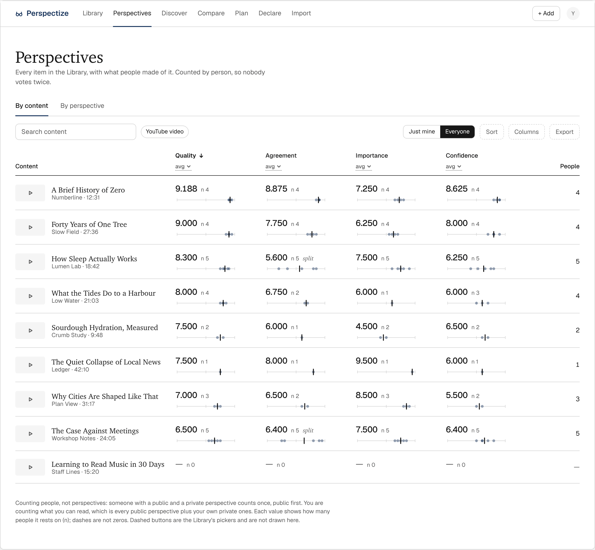
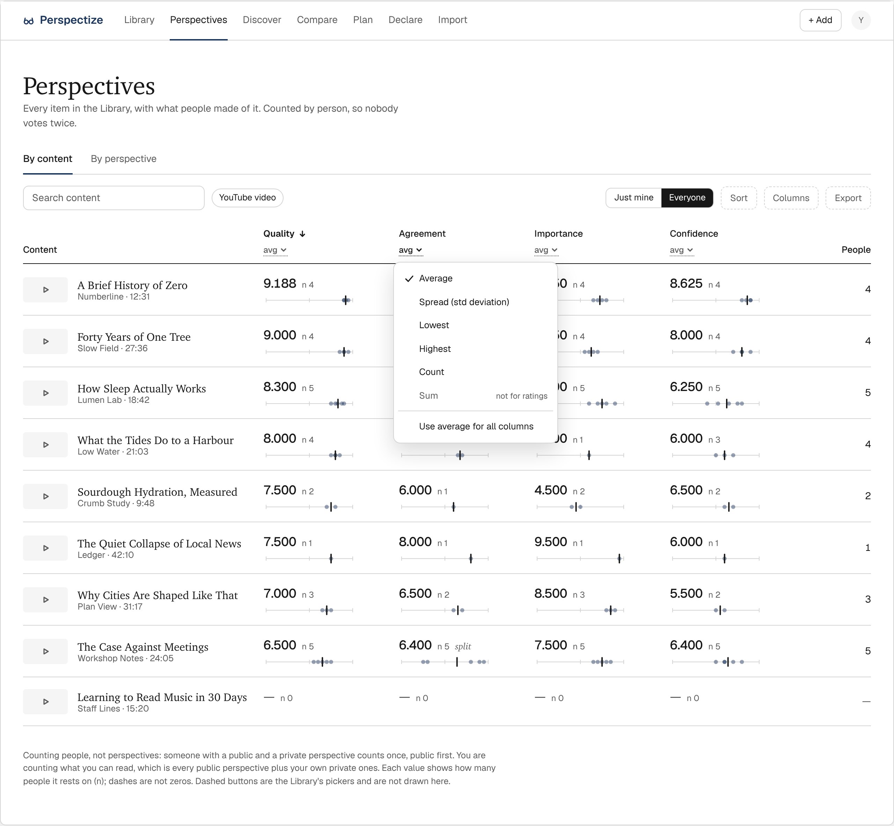
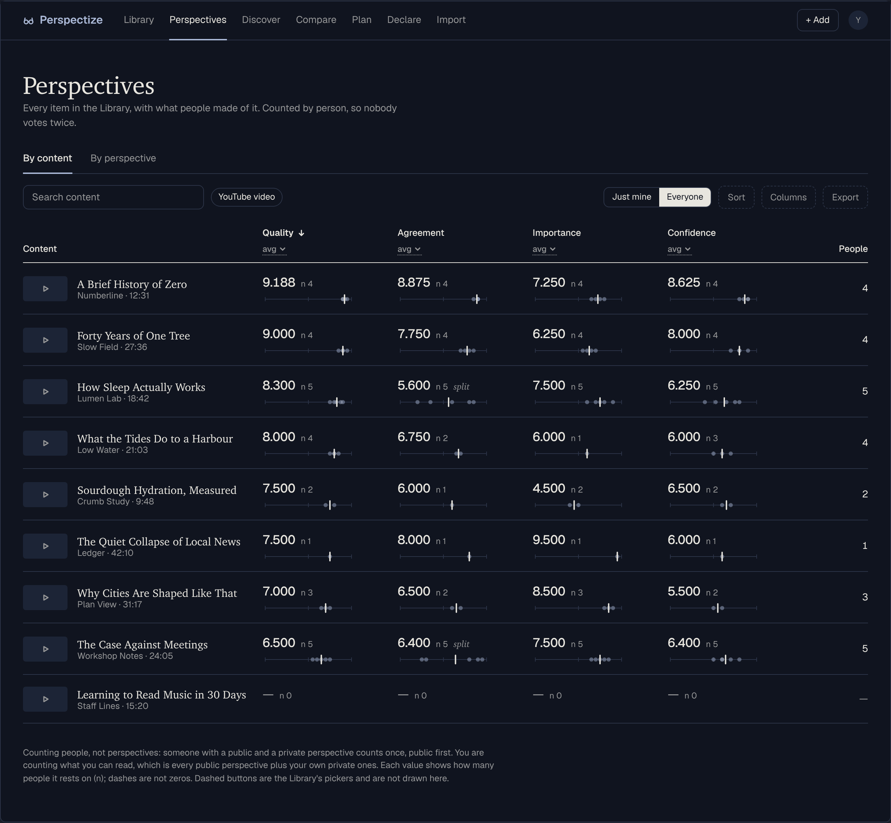
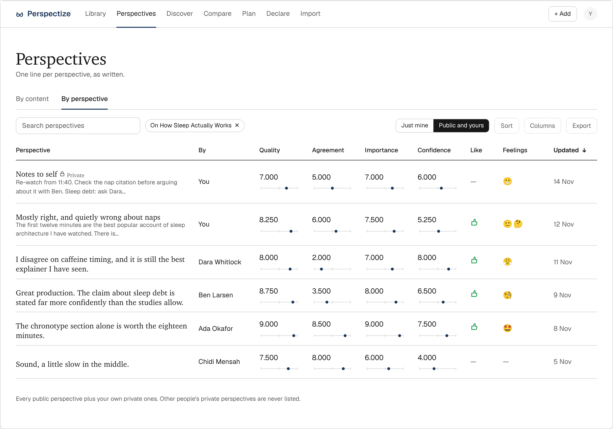
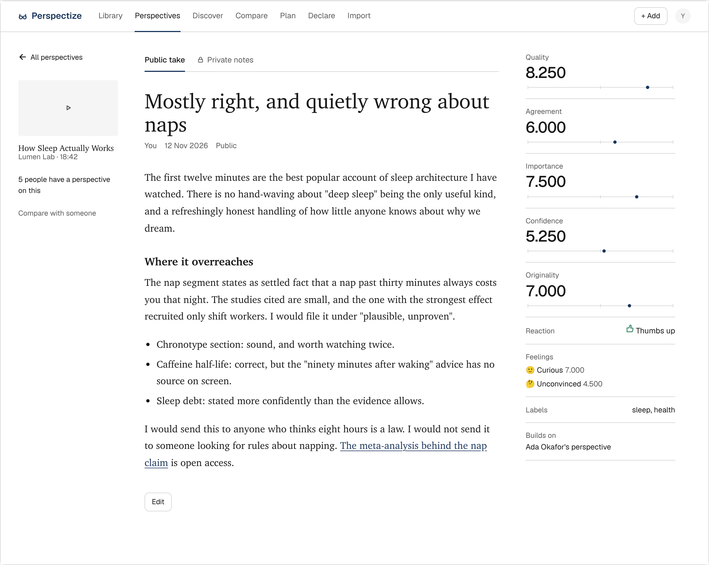
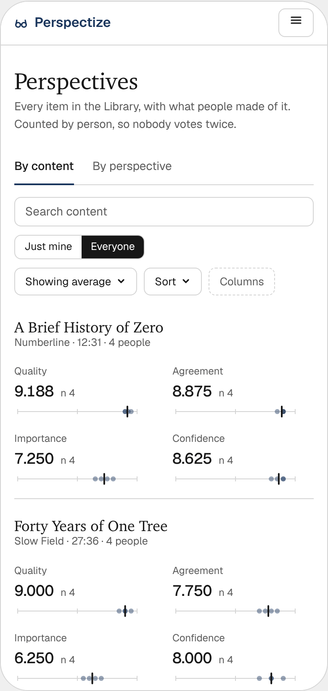
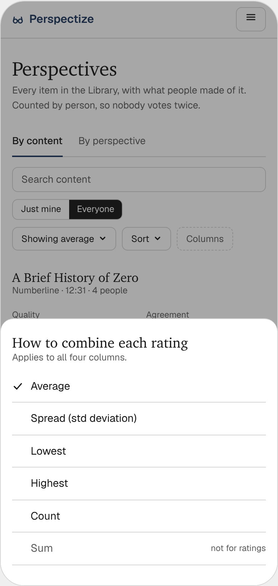
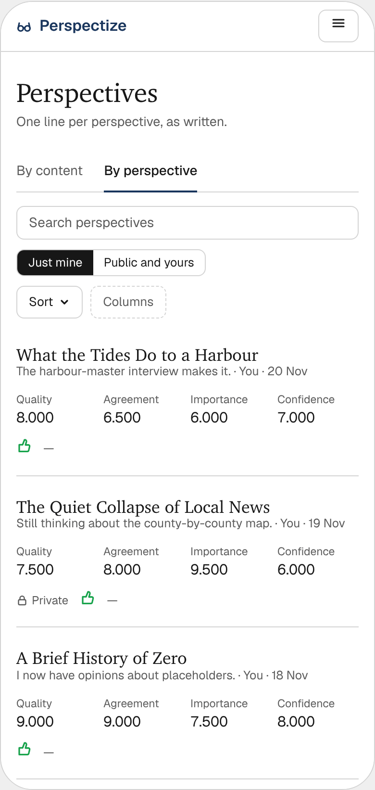
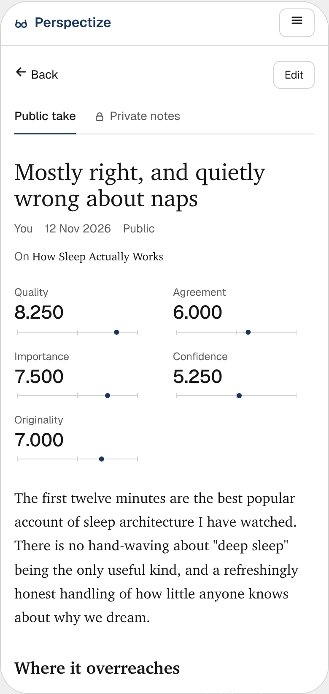

# Perspectives pages: preview

A throwaway, interactive mockup of the new **Perspectives** pages, desktop and phone, in three themes. It is a design artifact, not product code: fake data, nothing wired to the app, no backend or query budget.

It answers the UI-design gate of [#751](https://github.com/CodeWarrior-debug/perspectize/issues/751) (Perspectives Library with switchable aggregators) and [#752](https://github.com/CodeWarrior-debug/perspectize/issues/752) (one row per perspective), which ask for "a throwaway interactive preview (single HTML page) reviewed before any code". Neither issue is closed by this. Only the minimum sample is decided (none, for now); every other choice below is a proposal to argue with.

## Open it

Open [`perspectives-pages.html`](perspectives-pages.html) in a browser (GitHub shows it as source; download it or open it from a checkout). Use the **Desktop / Phone** and **Theme** controls at the top, and **Design notes** for the written proposals. A view can be linked directly:

```
perspectives-pages.html#vp=phone&page=persp&theme=midnight
perspectives-pages.html#vp=desktop&open=p1
```

`vp` is `desktop` or `phone`, `page` is `content`, `persp` or `read`, `theme` is `reading-room`, `archive` or `midnight`, `open` is a perspective id (`p1` to `p32`) and `filter` is a content id.

## The three pages

| Page | Row is | Source |
|---|---|---|
| **By content** | an item in the Library, with aggregates of its perspectives | #751 |
| **By perspective** | one perspective, with its own ratings | #752 |
| **One perspective** | the reading page a row opens | not in either issue; added so the list has somewhere to go |

"By content" and "By perspective" are two routes under one nav entry. Opening a content row drills into "By perspective", filtered to that item.



Each rating cell shows the number, how many people rated it (`n`), and the ratings people gave as dots on a 0–10 line. A tick marks the aggregate; "split" appears beside a wide spread. This is the one memorable mark, and it also answers #751's "where do people split" without a second column.

| Aggregator menu | Midnight theme |
|---|---|
|  |  |





The reading page sets the review in Charter at a reading measure and keeps the ratings in a quiet ledger beside it, using the same 0–10 line as the lists. When someone holds both a public and a private perspective on an item, the page offers **Public take** and **Private notes** (names from the multiple-perspectives spec, still to be confirmed).

### Phone

| By content | Aggregator sheet | By perspective | One perspective |
|---|---|---|---|
|  |  |  |  |

On a phone the list is a card list (as the Library's is below 860px). The aggregator is page-wide, set from a sheet, because per-column chips do not fit a card.

## Proposals, by the open question they answer

| Question | Proposal drawn here |
|---|---|
| #751 Q2: which aggregators | Average, spread (standard deviation), lowest, highest, count. Sum is listed but disabled for the four rating dimensions ("not for ratings"): adding 0–10 ratings means nothing. Median and percentiles later. |
| #751 Q3: minimum contributors | **None for now (the owner's call).** Every value shows from the first rating, with its own `n` beside it. Spread is the one exception: a single rating has no spread, so one person shows a dash and `n 1`. The cost is that with one other rater, their rating can be read from the average, lowest and highest. A floor can be added later without changing the layout. |
| #751 Q4: whose perspectives | "Everyone" counts every public perspective plus your own private ones (what you can read, not what exists). "Just mine" is your own. Friends and share lists wait for the sharing model ([ADR 0002](../../../adr/0002-sharing-model.md)). Defaults: Everyone on By content, Just mine on By perspective (as #752 says). |
| #751 Q5: name and nav | "Perspectives", beside Library. The other candidate was "Insights". Where it lives belongs to the flow-based navigation work ([#722](https://github.com/CodeWarrior-debug/perspectize/issues/722)); the phone header ignores the overflow in [#840](https://github.com/CodeWarrior-debug/perspectize/issues/840) on purpose. |
| One vote per person (ADR 0002 §7) | Someone with a public and a private perspective on one item counts once, public first. Cells say `n` for people, not perspectives. "Forty Years of One Tree" shows five perspectives and four people. |
| Missing is not zero | An item nobody rated shows a dash and `n 0`, never `0.000`. Each cell carries its own `n`, because a perspective can leave a dimension blank ("What the Tides Do to a Harbour"). |
| Private marks | A lock and the word "Private", as Compare does. |
| Sort, Columns, Export | Dashed buttons: they reuse the Library's pickers, and Export is [#800](https://github.com/CodeWarrior-debug/perspectize/issues/800). Not drawn here. |

Ratings are stored 0–10000 and shown 0–10 to three places, as in the app.

## Not covered

- The desktop-design gate of #751 (column widths and the `headerMinWidth` reserve for aggregator chips, tiers within the 1212px budget, theming across every preset). This preview is at the UI-structure level.
- The perspective editor (Edit opens the existing one), loading, error and signed-out states.
- Query cost: the real page needs one grouped query for any number of metrics, which is backend work.

## Rebuild

`preview.src.html` is the source of truth. `perspectives-pages.html` is the same file with the app's own fonts (Geist and Charter from `frontend/static/fonts`) inlined, so it is one self-contained file. Never hand-edit the output.

```bash
node docs/superpowers/specs/perspectives-pages-preview/build.mjs
```

Colours are copied from `frontend/src/app.css` (Reading Room, Archive and Midnight). Secondary text, hover and the chart marks are derived in the preview so they stay legible in every theme.
