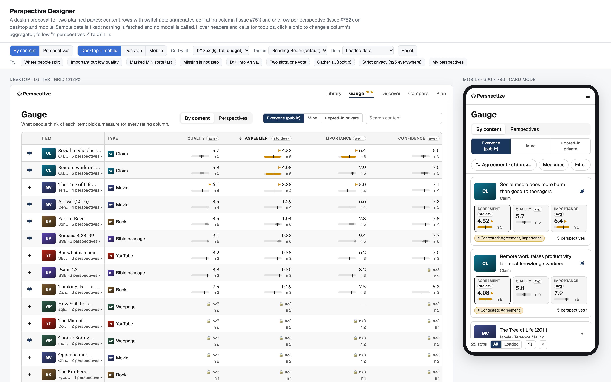

# Perspective Designer

An interactive design proposal for two planned pages, shown on desktop (1212px grid budget) and mobile (390px card list), side by side or one at a time:

- **By content** (issue #751): one row per content item, one column per rating measure, and a chip in each header that picks the column's single aggregator (avg, count, std dev, min, max, sum where offered).
- **Perspectives** (issue #752): one row per perspective, with Mine / Public scope, owner, claim, raw ratings, feelings and dates. A content row's "n perspectives ›" link drills into it.

It sits beside `tools/content-type-designer/` and follows the same setup: plain TypeScript compiled to `dist/`, one static `index.html`, no framework.



## Run it

From the repo root (so the fonts under `frontend/static/fonts/` resolve):

```sh
python3 -m http.server 8731
```

Then open <http://localhost:8731/tools/perspective-designer/index.html>. ES modules do not load from `file://`.

## Build

`dist/` is committed. After editing `src/`, rebuild and commit both:

```sh
npx tsc -p tsconfig.json
```

Any TypeScript 5+ works; the frontend's copy does too (`node ../../frontend/node_modules/typescript/bin/tsc -p tsconfig.json`). Do not commit a `package-lock.json` or `node_modules/` for this tool.

## What to try

- **Header chip:** click a rating header's chip to switch that column's aggregator. The column then shows, sorts and filters by that one aggregator; the header tooltip says so.
- **Gather all:** the "Gather all (tooltip)" scenario, or the Decisions switch, fetches every aggregator. The extra values appear only in the cell tooltip and mobile detail sheet. They are never extra columns and never sortable.
- **Scope:** the scope control (Everyone (public) / Mine / + opted-in private) is on both desktop and mobile. Private perspectives never enter the shared number by default. Your own value shows as "Mine" in the tooltip.
- **Masking:** values below the minimum contributor count show a lock with the n they have. Masked and empty values sort last in both directions and never match a filter ("Masked MIN sorts last").
- **Drill-down:** "n perspectives ›", or the cell tooltip's action, opens the Perspectives tab filtered to that item. Its banner reconciles "counted" with "you can open".
- **States:** loading, empty and error (Data select); five real themes from `frontend/src/app.css`; md tier (880px); stacked header layout; toolbar aggregator control.

The panels below the frames show:

- **URL and request:** the URL state, plus the GraphQL variables and query key the view would send.
- **Width budget:** headerMinWidth per column, against 1212px.
- **Design decisions:** every open question with its default, and a live switch where practical.
- **Backend contract:** what the screens assume of the backend.

## Files

| Path | What it holds |
|---|---|
| `src/fixture.ts` | 25 content items, 65 perspectives (ratings stored 0–10,000), planted edge cases |
| `src/registry.ts` | Metric and aggregator registries, privacy policy, formatting |
| `src/aggregate.ts` | Client stand-in for `contentMetrics`: scope, then one vote per user, then aggregate, then mask, then sort |
| `src/state.ts` | View state, columns, sort/filter, URL and request builders |
| `src/widths.ts` | Port of the Library's headerMinWidth (Geist advances, Balham chrome) plus the chip reserve |
| `src/grid.ts`, `src/cards.ts` | Desktop grid and mobile card list |
| `src/cells.ts`, `src/tip.ts`, `src/overlays.ts` | Cells, dark tooltips, menus, sheets and dialogs |
| `src/panels.ts` | Controls, scenarios, readouts, decisions, contract |
| `screenshots/` | A few reference captures |

## What it deliberately does not do

- **No real data:**
  - no network requests and no model calls
  - no persistence, so state resets on reload
  - the address-bar URL is shown, not written
- **Not app code:**
  - not Svelte, not AG Grid, not wired to the backend
  - no pagination; "Loaded" mode only demonstrates the client-side sort
- **Fixed inputs:**
  - the fonts are the app's and load only when served from the repo root
  - the themes are copied from `app.css` and will drift if that file changes
  - the minimum-contributor numbers and the contested threshold are proposals, not decisions
